# Hello World Dev Conference 2026 — 技術收穫與實戰筆記

這份文件整理 Hello World Dev Conference 2026 兩天共 13 個課程資料夾。內容以各場 `notes.md` 的實際記錄為主要證據，README 的官方簡介只用來補充課程背景；沒有把官方議程直接當成我已經驗證過的成果。10/14 10:10 的 Knowledge Graph 課程我沒有參加，因此該段只保留官方背景與既有素材，不列為個人收穫。

兩天的內容雖然分散在架構建模、AI Coding、事件驅動系統、授權、事故調查與 FinOps，但共同問題很一致：AI 或分散式系統真正進入工程流程後，不能只靠一個漂亮的 Prompt 或一次成功的 Demo。需要清楚的邊界、可追蹤的狀態、可重跑的驗證，以及失敗後知道怎麼停下來或恢復。

## TL;DR — 這兩天最值得記住的事

1. **AI 的品質不是 Prompt 單點問題。** Prompt 決定 AI 怎麼說，Context 決定它看得到什麼，Harness 則決定它能做什麼、如何被觀測、驗證與恢復。這是把 AI Coding 從個人技巧變成工程系統的關鍵分界。
2. **規則要變成可執行的檢查。** AGENTS、Skills、Prompt 與文件可以提供方向，但不能單獨當作保證；Lint、Architecture Test、Build、Test、Git Hook、CI 與權限閘門才是能阻止錯誤進入下一階段的證據。
3. **效能優化必須和一致性、可恢復性一起量。** 交易課的案例顯示，拿掉交易邊界可以提高局部吞吐量，卻可能產生部分提交與死鎖；真正可接受的方案，是在同一組負載條件下證明資料一致，並保留失敗時的診斷線索。
4. **可觀測性不等於診斷。** 告警、Metrics、Logs、Traces 只提供證據；AI 事故調查還需要規則先縮小範圍、工具取得上下文、結構化結果、歷史事件檢索與人工確認。
5. **最有價值的實作成果是可重跑的邊界。** MCP OAuth2 留下可執行的多階段授權實驗；Structurizr 資料夾則保留 DSL、ADR 與驗證資料，但 10/14 10:10 這場我沒有參加，不把它寫成現場成果。

## 兩天活動總覽

| 日期／時間 | 課程 | 這份整理的重點 | 詳細筆記 |
|---|---|---|---|
| 10/14 10:10 | 讓 AI 讀懂你的系統 with Knowledge Graph | **未參加**；僅整理官方背景與既有 Structurizr 素材 | [README](hello-world-notes/session/2026-10-14/1010-structurizr-opencode/README.md) · [notes](hello-world-notes/session/2026-10-14/1010-structurizr-opencode/notes.md) |
| 10/14 13:30 | LLM Wiki：企業內部知識問答系統的架構演進 | Raw／Wiki／Ops 分層、更新流程與評估邊界 | [README](hello-world-notes/session/2026-10-14/1330-llm-wiki/README.md) · [notes](hello-world-notes/session/2026-10-14/1330-llm-wiki/notes.md) |
| 10/14 13:30 | 用 AI 工作流重整事件驅動交易系統的一致性、效能與監測 | 批次化、交易邊界、鎖順序、Outbox 與 reconciliation | [README](hello-world-notes/session/2026-10-14/1330-event-driven-trading/README.md) · [notes](hello-world-notes/session/2026-10-14/1330-event-driven-trading/notes.md) |
| 10/14 14:15 | 懂行規的 Agent：把規範變成技能，自動化開發到部署 | Skills、權限與 pre-tool check 的治理邊界 | [README](hello-world-notes/session/2026-10-14/1415-agent-compliance-skills/README.md) · [notes](hello-world-notes/session/2026-10-14/1415-agent-compliance-skills/notes.md) |
| 10/14 15:15 | 雲端把花錢的權力交給了工程師，然後呢？ | 成本歸屬、異常偵測與優化證據 | [README](hello-world-notes/session/2026-10-14/1515-cloud-finops/README.md) · [notes](hello-world-notes/session/2026-10-14/1515-cloud-finops/notes.md) |
| 10/14 16:00 | 解構 Agentic AI 時代的系統架構：A2A、x402、AP2 | 官方架構概念；現場筆記尚未補齊 | [README](hello-world-notes/session/2026-10-14/1600-agentic-a2a-x402-ap2/README.md) · [notes](hello-world-notes/session/2026-10-14/1600-agentic-a2a-x402-ap2/notes.md) |
| 10/14 17:00 | 當架構設計被 AI 加速後，工程判斷力的養成與傳承該怎麼辦？ | 官方摘要；現場筆記尚未補齊 | [README](hello-world-notes/session/2026-10-14/1700-architecture-judgment/README.md) · [notes](hello-world-notes/session/2026-10-14/1700-architecture-judgment/notes.md) |
| 10/15 10:10 | 從一人 AI 工作流到團隊工程系統 | 把個人工作流變成可版本化、可驗證的團隊資產 | [README](hello-world-notes/session/2026-10-15/1010-ai-workflow-team/README.md) · [notes](hello-world-notes/session/2026-10-15/1010-ai-workflow-team/notes.md) |
| 10/15 11:15 | 當 AI 開始調查事故：讓 Kubernetes 告警從噪音變決策 | Webhook、背景處理、規則、Agent 與歷史事件 | [README](hello-world-notes/session/2026-10-15/1115-ai-incident-investigation/README.md) · [notes](hello-world-notes/session/2026-10-15/1115-ai-incident-investigation/notes.md) |
| 10/15 13:00 | 讓 AI Agent、MCP Server、CLI 安全登入的實作工作坊 | OAuth 2.0、PKCE、scope、audience 與 Gateway | [README](hello-world-notes/session/2026-10-15/1300-mcp-oauth2-workshop/README.md) · [notes](hello-world-notes/session/2026-10-15/1300-mcp-oauth2-workshop/notes.md) |
| 10/15 15:15 | 透過 ACP 解放 Terminal：打造 Coding Agent 的協作模式 | Session、Streaming、Permission 與 Agent Runtime | [README](hello-world-notes/session/2026-10-15/1515-acp-coding-agent/README.md) · [notes](hello-world-notes/session/2026-10-15/1515-acp-coding-agent/notes.md) |
| 10/15 16:00 | 從踩坑到 Harness Engineering | Prompt、Context、Tool、State、Observability、Verify／Recover | [README](hello-world-notes/session/2026-10-15/1600-harness-engineering/README.md) · [notes](hello-world-notes/session/2026-10-15/1600-harness-engineering/notes.md) |
| 10/15 17:00 | Lint + Architecture Test：Agentic Coding 防護牆 | 將依賴規則與架構邊界變成 CI 可執行的護欄 | [README](hello-world-notes/session/2026-10-15/1700-lint-architecture-test/README.md) · [notes](hello-world-notes/session/2026-10-15/1700-lint-architecture-test/notes.md) |

10/14 的兩場 13:30 課程時間重疊，因此這裡不宣稱兩場都完整參與；各自的內容只依現有筆記整理。10/14 10:10 的 Knowledge Graph 課程則明確標記為未參加。

## 核心技術與工程觀念

### 1. Architecture as Code 的價值在於共享決策，不只是畫圖

課程資料把架構模型放進 DSL，並用 ADR（Architecture Decision Record，架構決策紀錄）說明為什麼重用代理商既有的實名制 App 與門市取貨系統，而不是重新打造買家 App 或門市系統。由於我沒有參加這場，以下只把它當成既有資料中的技術背景，不當成我的現場心得。這個做法本身解決的是「人和 Agent 各自從不同上下文理解系統」的問題：系統邊界、外部依賴、資料流與取捨都能被版本控制、檢視與重新產生。

真正重要的不是圖的數量，而是模型能否回答：誰使用系統、哪一個系統負責實名驗證、抽選結果往哪裡送、哪些東西明確不在本次範圍內。DSL 與 ADR 讓這些決策成為可 review 的工程資料，而不是只存在簡報或某個人的記憶中。

### 6. Agent 一旦能代表公司行動，就需要身分、授權、預算與稽核

A2A、x402、AP2 與 Ghost Pay 的筆記把「Agent 自動做事」拆成四個不同問題：A2A 定義任務交接與 `input-required` 等狀態；x402 用 HTTP 402 將付費放回 API 呼叫流程；AP2 說明 Agent 為什麼有權付這筆錢、可花多少與可向誰付款；Ghost Pay 則把付款攔截與簽署放到 Kubernetes／Service Mesh 層，避免每個業務 Agent 自己保存私鑰、處理區塊鏈與預算。

真正該帶走的不是「AI 可以用區塊鏈付款」，而是 Agent 變成系統角色後，必須回答：我是誰、我被授權做什麼、預算上限是多少、最後做了什麼。這和 MCP OAuth2、Agent Compliance 的權限與稽核問題是同一類治理問題。

### 7. AI 加速架構設計後，人的價值轉向不可逆決策的判斷

架構判斷課補上了「AI 提案很快，但誰負責停下來想」這一面。可用做錯後回頭的代價判斷人與 AI 的邊界：影響範圍越大、依賴者越多、錯誤越晚被發現、回復協調越困難，就越不應直接由 AI 決定。

實務上可採人先形成理解與初步方案，AI 再提出替代方案、挑戰假設與比較 trade-off；Design Review 不只記錄最後選項，也保留被否決的方案與理由。這些被否決的方案是把資深工程師的隱性經驗轉成可傳承資料的方式。

### 2. AI Coding 要從「會產生程式」變成「有邊界的執行流程」

團隊工作流、Agent Compliance、ACP、Harness 與 Lint 課程互相接上了同一條線：

```text
需求／Context
  → Agent 執行
  → 工具與權限邊界
  → 可觀測的狀態與事件
  → Lint／Test／Architecture Test
  → 人工或系統驗證
  → 失敗時重試、回復或停止
```

AGENTS、Skills、Policy 仍然有用，但它們比較像「告訴 Agent 應該怎麼做」。真正的防護牆要由權限、pre-tool hook、檢查命令、CI 保護與人工核准補上。ACP 的重點也不是把 Terminal 換成聊天視窗，而是要有長生命週期的 Session、Context、Streaming、工具呼叫、取消／恢復和不同 Agent Runtime 的共同邊界。

### 3. 驗證要檢查結果，也要檢查系統是否仍然正確

事件驅動交易的案例最清楚地展示了這一點。AI 可以提出批次 SQL、拆 scheduler、調整交易邊界等候選方案，但每個方案都要在固定負載下看吞吐、延遲、queue backlog、錯誤與資料 reconciliation。某個移除 transaction 的方案局部吞吐量上升，卻因部分提交與鎖問題被否決；某個改善 scheduler 的方案通過短測，後來又因 Redis reservation repair 的推導方式產生 duplicate trade。

因此「測試通過」至少要拆成三種問題：

- **功能正確性：** API 或流程是否得到預期結果。
- **資料一致性：** 跨服務的 ID、資產、狀態與數量是否能對帳。
- **運行特性：** 在相同負載下 latency、吞吐、backlog、cost 是否可接受。

### 4. 可觀測性提供證據，診斷系統才把證據變成決策

事故調查課把人通常採用的流程拆開：告警只是入口，接著還要取得 Metrics、Traces、Logs、Kubernetes events 與相關設定，形成假設並驗證。課程提出的 SRE Agent 架構把 Webhook Receiver 和背景處理分離：前者快速回應監控系統，後者才執行工具呼叫、分析、儲存與通知。

這個分離避免告警入口被模型或外部查詢拖住，但也留下需要補齊的工程問題：Queue、Retry、Timeout、Idempotency、工具權限與分析結果的可信度。規則引擎應先把告警情境化，Agent 再負責跨資料源整理與解釋；歷史事件向量檢索可以補充即時遙測，但不能取代即時證據。

### 5. 知識、狀態與成本都要被治理

LLM Wiki 將知識拆成 Raw、Wiki、Ops 三層：Raw 保留原始證據，Wiki 組織來源、概念、實體與查詢，Ops 管理更新、review 與 publish。這比把所有文件切 chunk 後直接 embedding 更容易追蹤版本與回溯錯誤。筆記中的評估也提醒，題目從 10 題變成 11 題、版本與測試條件改變時，不能把一次 11/11 當成通用準確率。

FinOps 課則將同樣的治理思路放到雲端成本：先知道成本歸屬與使用量，再處理異常、閒置資源與預算偏差。課堂記錄的雲端桌面案例有數字變化，但單位、期間與掃描範圍尚未確認，因此只能當成待驗證的案例，不能直接換算成公司節省金額。

## 10/14 課程精華

### 讓 AI 讀懂你的系統 with Knowledge Graph（未參加）

講師與時間：Neo Hsu，2026-10-14 10:10。

#### 官方背景

官方內容把 Knowledge Graph 放在 Codebase → Index → Graph → Agent Retrieval 的流程中，用結構化關係補足純向量檢索的限制。這段是課程資料的技術背景，不是我現場聽到的心得，也不宣稱我完成了該場 Workshop。

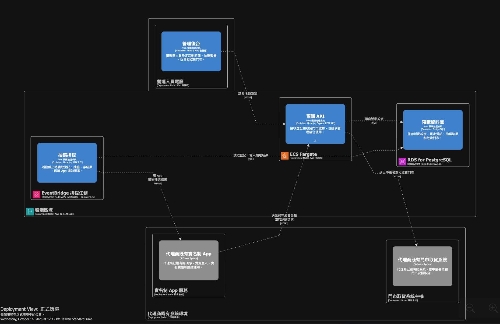

這張圖屬於資料夾內既有實作素材，放在 Summary 只作為架構模型的閱讀入口；更完整的參與狀態與圖片說明已放在 [notes](hello-world-notes/session/2026-10-14/1010-structurizr-opencode/notes.md)。

#### 解決的問題與方法

課堂主軸是 Codebase → Index → Knowledge Graph，再讓 Coding Agent 依圖譜縮小 Context Retrieval 範圍。這個思路對目前以 chunking、Embedding、Qdrant、LLM 為主的 RAG 有補充價值：向量檢索回答「相似」，圖譜更適合回答「誰依賴誰、哪個元件負責什麼、改動會影響哪裡」。

#### 可供後續閱讀的方向

- 將知識檢索從「找相似文字」擴展為「找可解釋的系統關係」。
- 若之後要研究，先用小型 Geo RAG 或單一模組做 POC；目前沒有我的現場筆記，不先把這列為個人行動結論。

#### 詳細資料

[README](hello-world-notes/session/2026-10-14/1010-structurizr-opencode/README.md) · [notes](hello-world-notes/session/2026-10-14/1010-structurizr-opencode/notes.md)

### LLM Wiki：企業內部知識問答系統的架構演進

時間：2026-10-14 13:30–14:00；講師：張維峻 (Justin)。此場與同時段的事件驅動交易課重疊，以下依筆記整理，不宣稱完整參與。

#### 核心觀念

企業問答的瓶頸不只在 Retriever，而在來源文件沒有被整理、版本沒有被管理、答案沒有可驗證的證據。LLM Wiki 把知識治理往前移，讓 RAG 取得的不是一堆無上下文的片段。

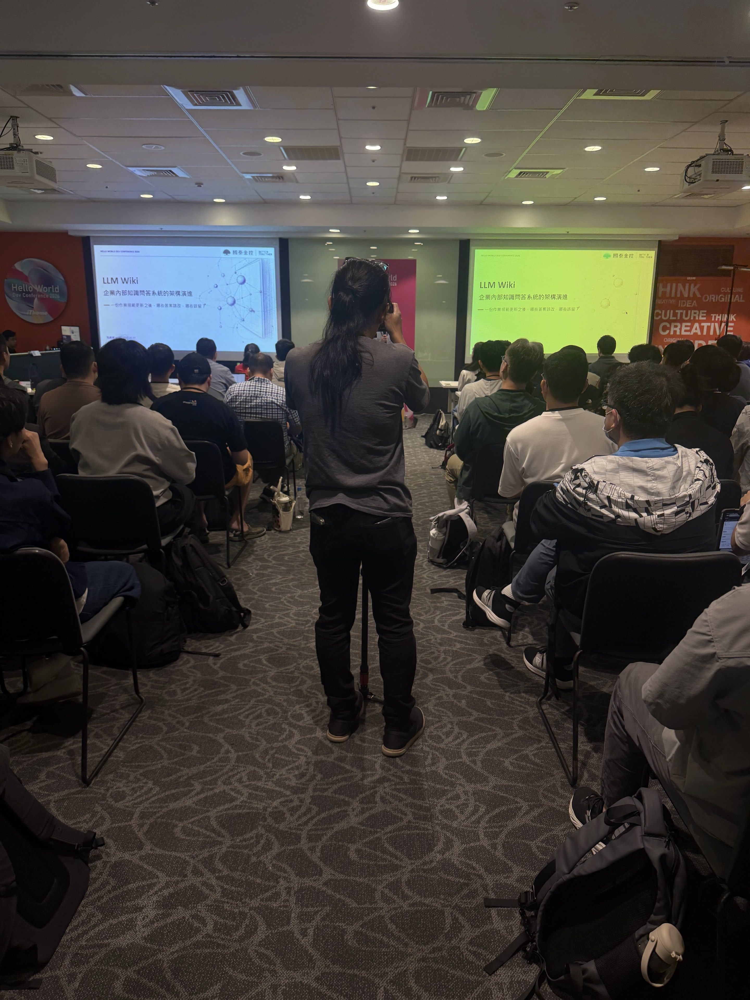

這張照片可辨識課程主題與知識圖譜視覺，作為現場素材入口；Raw／Wiki／Ops 的具體分層仍以文字筆記為準。

#### 解決的問題與方法

筆記整理出的三層是：Raw 保存原始資料與來源；Wiki 整理 source、concept、entity、query；Ops 管理 `purpose.md`、review queue、更新與發布。更新流程是 Compile → Validate → Review → Publish。Embedding 是檢索工具，不應被誤當成唯一的知識真相。

#### 講者實戰經驗

筆記記錄一組小型評估：v1 有 10 題、基線 8/10；v2 有 11 題、基線 10/11；第一次更新後 9/11，再修復到 11/11。這組數據支持「內容更新可能讓答案退步，需有回歸題目」的觀察，但題數、版本與條件不同，不能解讀成通用準確率或完整 benchmark。

#### 這堂值得帶走的東西

- 保留 Raw 與結構化知識，才能在答案錯時回到原始證據。
- 把知識更新當成有 review 與回歸驗證的變更，而不是單純重新建立 embedding。

#### 詳細資料

[README](hello-world-notes/session/2026-10-14/1330-llm-wiki/README.md) · [notes](hello-world-notes/session/2026-10-14/1330-llm-wiki/notes.md)

### 用 AI 工作流重整事件驅動交易系統的一致性、效能與監測

時間：2026-10-14 13:30–14:00；講師：蔡宜庭 (ET)。與 LLM Wiki 時段重疊，以下只根據現有筆記與其中記錄的案例整理。

#### 核心觀念

AI 可以加速提出效能優化方向，但交易系統不能只看 TPS。每次修改都要同時檢查一致性、backlog、延遲、錯誤與資料對帳。

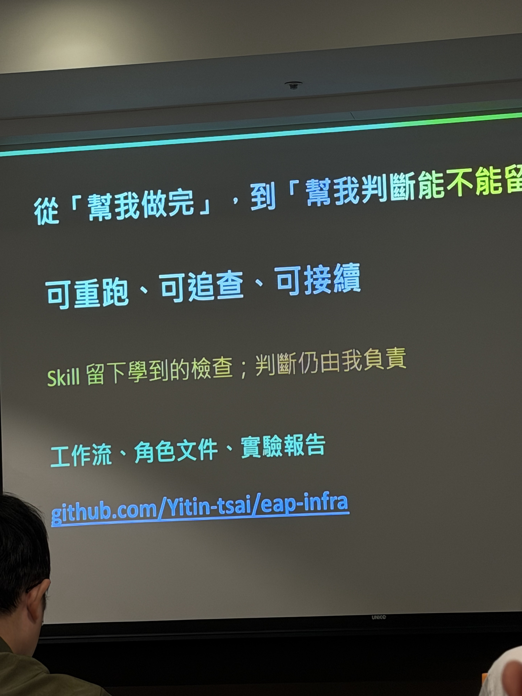

投影片把 AI 工作流的產出拉回工程責任：Skill 可以留下檢查，但最後仍要由人判斷結果是否正確。

#### 解決的問題與方法

案例一把逐筆清理改成批次 SQL，30,000 次更新降到 32 次；記錄中的 BUY trade rate 從 664 提升到 922 trades/s，backlog 從 14,110 降到 6,261，p95 從 13.6 秒降到 4.5 秒，30,000 個 ID／資產仍正確。這是有代價的優化：批次化提高資料庫效率，但仍需確認批次邊界與失敗重跑行為。

案例二拿掉 transaction 後，局部 settlement throughput 從 11,799 到 20,405/s（+72.9%），但會有 partial commit，角色交換時還出現 deadlock，因此方案被撤回，改回每事件 transaction 並固定 Wallet UUID lock order。這個取捨把「正確性優先」變成具體決策，而不是口號。

案例三拆開 cleanup 與 TradeOutboxRelay scheduler 後，短測吞吐與 backlog 改善，但後續發現 MatchEngine 與其他服務的 trade 數量差一筆。根因是 Redis reservation repair 用 order ID 加 timestamp 猜 tradeId；改成儲存精確 tradeId 後，跨服務數量一致，但 800 orders/s 仍未通過效能門檻。修掉 correctness bug 不代表 performance gate 自動通過。

#### 講者實戰經驗

長測記錄使用 k6，60 秒 warm-up、900 秒測量，約 200 orders/s；某次單機結果為 192,000 orders、96,000 trades、ID／資產一致且 backlog 歸零。但這是特定版本與環境的驗證，不是 production SLA，也不能直接推論所有部署都能達到同樣數字。

#### 這堂值得帶走的東西

- 用固定負載、可對帳的資料與 failure test 評估 AI 提出的修改。
- 把 tradeId、reservation 等跨服務關係存成明確資料，不要在修復流程中靠時間或推測重新組合。

#### 詳細資料

[README](hello-world-notes/session/2026-10-14/1330-event-driven-trading/README.md) · [notes](hello-world-notes/session/2026-10-14/1330-event-driven-trading/notes.md)

### 懂行規的 Agent：把規範變成技能，自動化開發到部署

講師與時間：張云姵 (Sarah)，2026-10-14 14:15–15:00。

#### 核心觀念

不能期待 LLM 自己遵守命名、資源、API 或部署規範。規則應分成 Agent 可理解的 Skills 與系統真正會阻擋動作的權限、pre-tool hooks、CI 和人工核准。

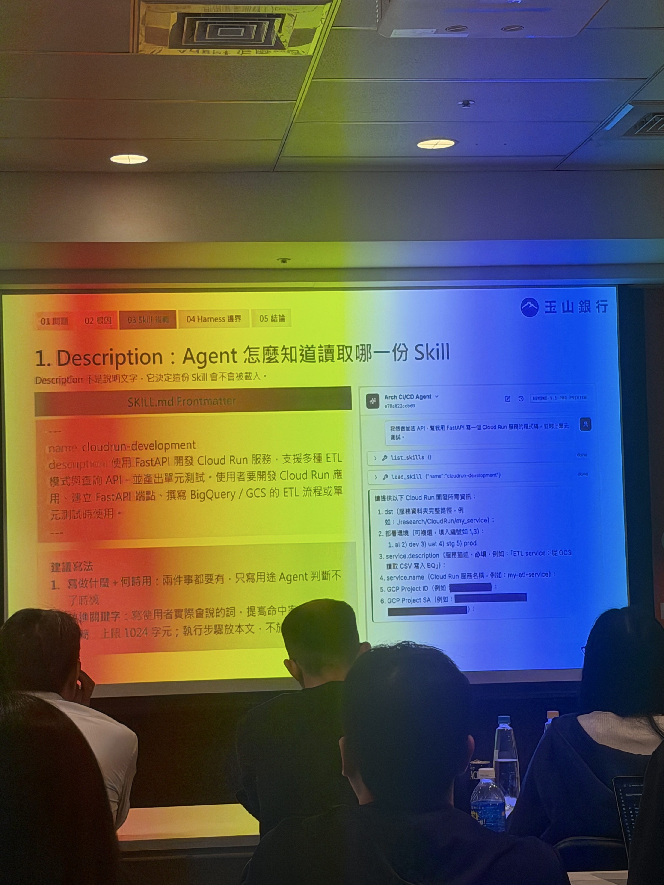

圖中用 `SKILL.md`、description 與 Agent 讀取 Skill 的畫面示範：Skill 應有清楚責任與輸出，而不是把所有規則塞進一份巨大 Prompt。

#### 解決的問題與方法

筆記將軟約束與硬約束分開：Prompt、文件與 Skills 是軟約束；權限、pre-tool check、不可逆操作的人審是硬約束。開發與部署 Skill 也應分責任，讓 Agent 在執行過程中遇到規則，而不是只在最後看一份說明。

#### 講者實戰經驗

現有筆記沒有保留可重跑的公司範例或程式碼成果，因此不把它寫成已完成的治理導入。實務風險則很明確：Agent 可能執行非預期 commit 或跨越權限邊界，不能只靠模型自律。

#### 這堂值得帶走的東西

把一次事故或違規案例轉成下一次可執行的檢查；先從低風險、可逆操作自動化，跨環境或不可逆操作保留人工核准。

#### 詳細資料

[README](hello-world-notes/session/2026-10-14/1415-agent-compliance-skills/README.md) · [notes](hello-world-notes/session/2026-10-14/1415-agent-compliance-skills/notes.md)

### 雲端把花錢的權力交給了工程師，然後呢？

講師與時間：林宗穎 (Kater)，2026-10-14 15:15–15:45。

#### 核心觀念

FinOps 不是月底看帳單，而是把預估需求、預算分配、使用量、成本歸屬、異常與優化串成循環。成本問題應回到系統與流程，不先把責任歸咎於個人。

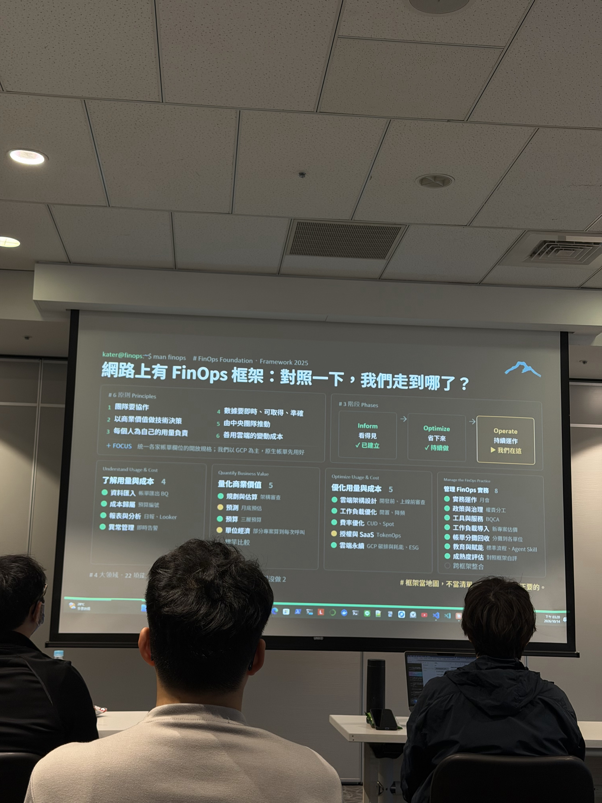

這張投影片把成本治理拆成可觀測、可量化與持續運作的階段，支持筆記中的成本循環整理。

#### 解決的問題與方法

筆記整理的流程是 estimate demand → allocate → monitor → compare budget → analyze anomaly → adjust → track。需要先區分 allocation rate 與 consumption rate，否則「預算用了多少」和「實際資源消耗多少」會混在一起。

#### 講者實戰經驗

雲端桌面掃描約 30 秒、調整排程與關閉低效資源後，筆記記錄成本從約 90w 降到低於 20w，再到 70w；但單位、期間與 30 秒的定義尚未確認，所以不把它換算成公司月省金額。

#### 這堂值得帶走的東西

先建立成本可見性、資源歸屬與預算告警，再做 idle／overprovisioning POC；任何節省結論都要附上時間窗、基準與資源範圍。

#### 詳細資料

[README](hello-world-notes/session/2026-10-14/1515-cloud-finops/README.md) · [notes](hello-world-notes/session/2026-10-14/1515-cloud-finops/notes.md)

### 解構 Agentic AI 時代的系統架構：A2A、x402、AP2

講師與時間：蕭兆洋 (Charles Hsiao)，2026-10-14 16:00–16:45。

#### 核心觀念

如果 Agent 未來要自己找服務、交接任務、購買資料或花公司的錢，系統必須同時處理合作、付款、授權與稽核。四個概念可以先用一句話記：A2A 是 Agent 怎麼合作，x402 是怎麼付款，AP2 是為什麼有權付款，Ghost Pay 是讓付款在基礎設施完成。

#### 解決的問題與方法

A2A 把長任務的交接狀態標準化，例如 Agent 缺少 URL 時回報 `input-required`，補齊後再繼續，而不是把每件事壓成一次 Request／Response。x402 讓付費 API 先回 `402 Payment Required`，Agent 完成付款後再取得資料。AP2 對付款增加委託書、預算與供應商限制，例如每次最多 5 美元、每天最多 50 美元。Ghost Pay 則讓 Istio／Envoy 攔截 402，交給 Paymaster 與 Facilitator 完成付款，業務 Agent 不必自己保存私鑰或寫支付流程。

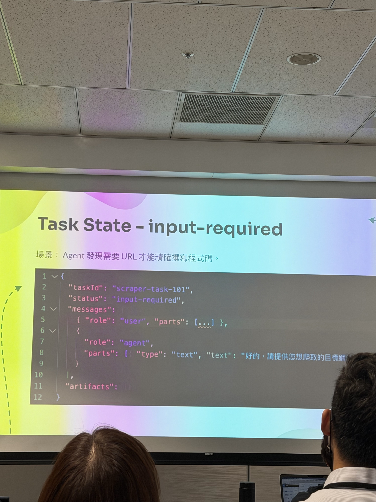

這張投影片具體呈現 A2A 的重點：任務不只會成功或失敗，也可能停在等待輸入，並保留任務 ID 與訊息上下文。

#### 講者實戰經驗

Security Agent 自動購買資安情報是主要案例：Agent 呼叫付費漏洞情報 API，收到 402 後完成付款，再繼續分析。工程取捨是把支付能力集中在基礎設施層，降低每個 Agent 自己處理私鑰、區塊鏈、預算與支付錯誤的風險；代價是平台層必須承擔更嚴格的身分、授權、稽核與故障處理責任。

#### 這堂值得帶走的東西

設計 Agent-to-Agent 或 Agent-to-Service 流程時，先把 Identity、Authorization、Budget、Payment、Audit 分開定義。能付款不代表有權付款，能呼叫 API 也不代表知道長任務目前處於什麼狀態。

#### 詳細資料

[README](hello-world-notes/session/2026-10-14/1600-agentic-a2a-x402-ap2/README.md) · [notes](hello-world-notes/session/2026-10-14/1600-agentic-a2a-x402-ap2/notes.md)

### 當架構設計被 AI 加速後，工程判斷力的養成與傳承該怎麼辦？

講師與時間：林承毅 (Jed)，2026-10-14 17:00–17:30。

#### 核心觀念

AI 把架構設計從幾天壓縮到幾小時，但也可能跳過 Context 內化與方案掙扎。不能讓 AI 提出一個看似合理的方案，取代人判斷哪些決策值得停下來想、哪些錯誤會很難回頭。

#### 解決的問題與方法

用做錯後回頭的代價劃分人與 AI 的邊界：影響範圍、下游依賴、發現時間與回復協調越大，越應由人負責決策。實作上先由人形成理解與初步方案，再讓 AI 提替代方案、挑戰假設與比較 trade-off。Design Review 同時記錄最後方案、被否決的方案、限制與理由。

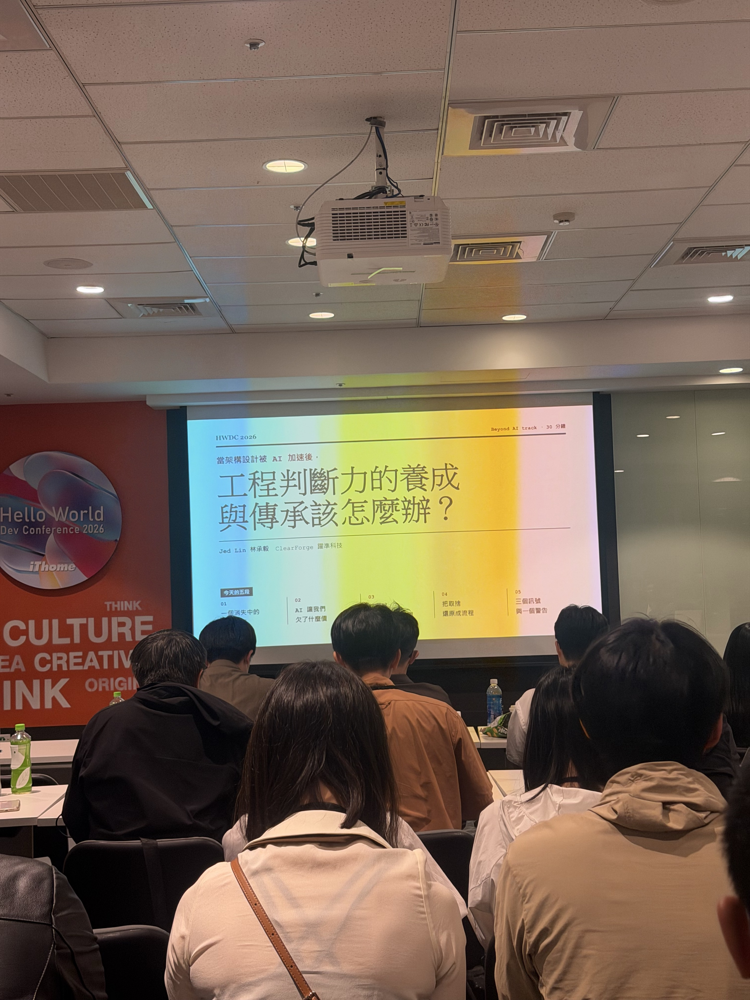

這張投影片是本場主題與課程結構的現場證據；重點不是把 AI 排除，而是保留人的判斷與傳承機制。

#### 講者實戰經驗

筆記沒有記錄特定系統案例或量化結果，因此不補造實際導入成效。可確認的做法是把被否決方案與理由視為設計資產，讓後來的人知道「為什麼沒有選另一條路」。

#### 這堂值得帶走的東西

每次 AI 參與架構設計，都至少留下 decision reversibility、human／AI boundary、alternative analysis 與 ADR；判斷力的成長要看能否說明為什麼這樣設計，以及下次會如何改善。

#### 詳細資料

[README](hello-world-notes/session/2026-10-14/1700-architecture-judgment/README.md) · [notes](hello-world-notes/session/2026-10-14/1700-architecture-judgment/notes.md)

## 10/15 課程精華

### 從一人 AI 工作流到團隊工程系統

講師與時間：謝浩哲 (HAO)，2026-10-15 10:10–10:55。

#### 核心觀念

個人用 AI 變快，不等於團隊交付品質穩定。要把需求背景、目標、非目標、驗收條件、規則、Skill、檢查與 review 變成版本化的團隊資產。

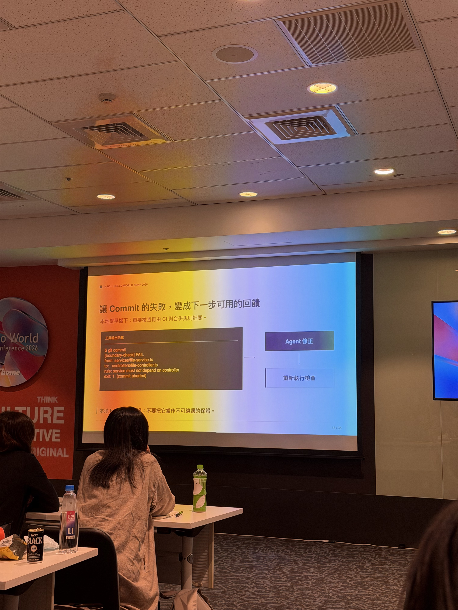

畫面呈現規則檢查失敗後回到 Agent 修正、再重新驗證的迴圈；這比把 commit 當成不可解釋的阻擋更容易形成團隊工作流。

#### 解決的問題與方法

筆記整理出的工作迴圈是：Meta-Agent 規劃 → 實作／測試 → 驗證／修正 → atomic commit → policy review → business review → human review。Linter、Git Hook、CI 應使用同一套可重跑命令，讓 commit 失敗成為回饋而不是模糊的阻擋。

角色可拆成 Policy、Skill、Tool、Agent、Human；AI review 不能取代 PR approval 與最後的風險承擔。團隊導入則先從一個專案開始，把專案規則與共用 Skills 分層管理。

#### 講者實戰經驗

目前筆記有流程與決策原則，但沒有本場實際建立的可執行 repo 或 benchmark；因此不宣稱已完成團隊導入。

#### 這堂值得帶走的東西

用「需求契約 + 驗收條件 + 自動檢查 + 人工風險核准」取代只追求一次生成成功；把個人工作流拆成可以交接與審查的步驟。

#### 詳細資料

[README](hello-world-notes/session/2026-10-15/1010-ai-workflow-team/README.md) · [notes](hello-world-notes/session/2026-10-15/1010-ai-workflow-team/notes.md)

### 當 AI 開始調查事故：讓 Kubernetes 告警從噪音變決策

講師與時間：依現有 Session 資料整理，2026-10-15 11:15。

#### 核心觀念

AI 事故調查不是收到告警後丟給模型一次，而是把告警轉成可執行任務，再依規則與工具取證、整理結構化結果、通知與保存。

#### 解決的問題與方法

現場筆記將流程拆成：Monitoring → Webhook Receiver → Background Worker → Agent tools → 結構化分析 → DB／通知。Webhook 只負責快速回應，耗時的查詢與模型分析移到背景處理。Agent 內部也不是單次 Prompt，而是 task → instructions → tool selection → tool result → 是否需要更多工具 → pass/fail → save／notify。

規則引擎先把告警情境化，Agent 再整合 Metrics、Logs、Traces 與 Kubernetes events。歷史事故向量檢索可協助找相似案例，但必須和即時遙測分開看，不能用歷史相似度取代當下證據。

#### 講者實戰經驗

目前筆記沒有足夠資料確認 queue、retry、timeout、idempotency、工具權限與 root-cause 驗證的完整實作。模型成本／成功率照片也缺少樣本、版本、幣別與評估條件，不能當通用 benchmark。

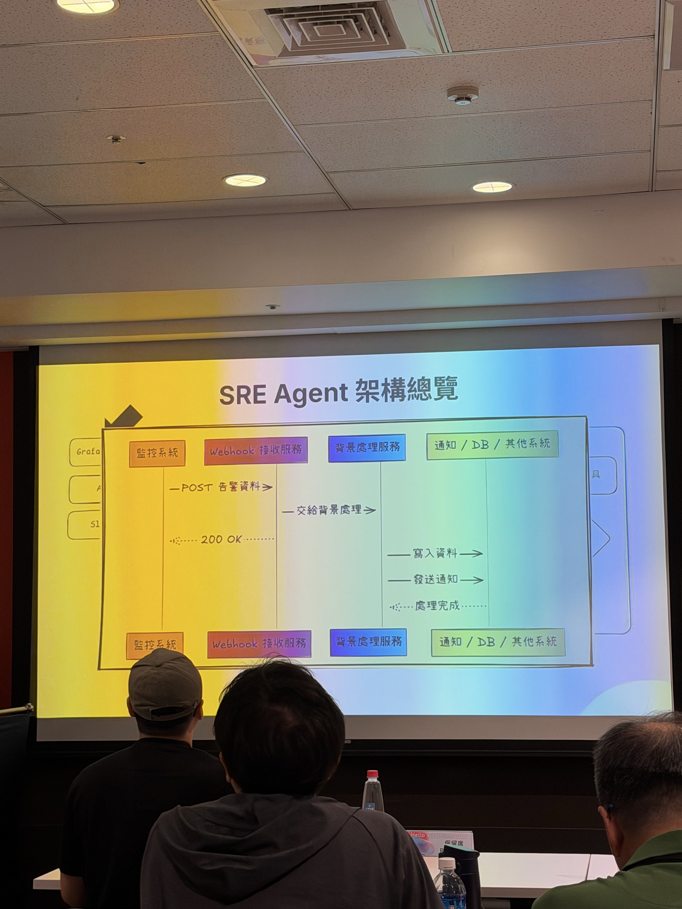

圖中可看到課堂提出的基本責任分離：監控系統送告警給 Webhook，背景服務處理，再把結果寫入資料或送出通知。

#### 這堂值得帶走的東西

- 先做 Alert → Rule → Agent → Report 的最小 POC，驗證證據完整度與人工調查時間是否真的下降。
- 把「模型說了什麼」和「模型實際查了哪些資料」分開保存，否則無法 debug 或回溯。

#### 詳細資料

[README](hello-world-notes/session/2026-10-15/1115-ai-incident-investigation/README.md) · [notes](hello-world-notes/session/2026-10-15/1115-ai-incident-investigation/notes.md)

### 讓 AI Agent、MCP Server、CLI 安全登入的實作工作坊

講師與時間：吳柏毅 (appleboy)，2026-10-15 13:00–15:00。

#### 核心觀念

MCP 工具一旦碰到使用者資料，就不能只驗「有沒有 Token」。工作坊用 OAuth 2.0、PKCE、scope、resource／audience、JWKS 與撤銷情境，把 Client、Authorization Server、Resource Server 的責任拆清楚。

#### 解決的問題與方法

實驗路線從匿名 MCP Server 開始，經過 401 與 Protected Resource Metadata 找到登入端點，再做 authorization code + PKCE，接著驗證簽章、issuer、audience、expiry、access type 與 scope。`notes:read` 控制入口，`notes:write` 控制寫入工具；A 的 Token 不能打 B，代表 audience／resource 隔離有實際作用。Kong 的角色是集中入口授權，不會代替使用者登入，也不會自動解決即時 Token 撤銷。

#### 實際成果

本地 `repo/` 是可執行教材，現有筆記記錄已驗證 Lab 01–05 的 Python 路線與 OAuth／PKCE／Token／scope／audience／revoke 行為；Lab 06 Kong Gateway 仍應標成待驗證或延伸，不能把 repo 存在等同於本機已完成 Gateway 流程。`.env` 與 Token 檔案不應放進公開摘要。

#### 這堂值得帶走的東西

授權流程的每一層都要能說明「誰代表誰、Token 發給誰、哪個 scope 允許什麼、撤銷何時生效」。離線 JWT 驗證不等於即時撤銷；這是 Gateway 或 Resource Server 設計時必須明確接受的 trade-off。

#### 詳細資料

[README](hello-world-notes/session/2026-10-15/1300-mcp-oauth2-workshop/README.md) · [notes](hello-world-notes/session/2026-10-15/1300-mcp-oauth2-workshop/notes.md) · [實作 repo](hello-world-notes/session/2026-10-15/1300-mcp-oauth2-workshop/repo/)

### 透過 ACP 解放 Terminal：打造 Coding Agent 的協作模式

講師與時間：Neo Hsu，2026-10-15 15:15–15:45。

#### 核心觀念

把 Coding Agent 接進 Discord 或 Telegram 不只是把訊息轉成 headless CLI 呼叫；真正難的是讓工作持續存在、可以觀察、取消、恢復並安全交接。ACP（Agent Client Protocol）提供 Client 與 Agent Runtime 之間的共通互動邊界。

#### 解決的問題與方法

筆記中的 OpenAB 架構是聊天平台 → Adapter → Dispatcher／Session Pool → ACP → Agent Runtime。每個 thread 對應一個 Agent Session，事件以 streaming 回報，還要處理 session TTL、context storage、tool call、permission、cancel／resume、錯誤與不同 CLI 的事件格式差異。

平台權限和 Agent 權限要分開：Discord allowlist／bot loop 防護不能取代 Codex 的 sandbox mode 或 full-access 風險控制。多 Agent 協作還需要 trusted bot、mention 規則與 max bot turns，否則會形成無限互相觸發。

#### 講者實戰經驗

現場筆記記錄的主要踩坑是：單次 headless request 不會自動保留聊天上下文；每個 harness 的 streaming log 不同；舊的 Agent mode 名稱可能失效；部署行為尚未在本地完整驗證。因此不把 OpenAB 寫成已在本專案部署完成。

#### 這堂值得帶走的東西

聊天整合層的核心不是 UI，而是 Session Runtime。先定義 session start／continue／end、事件格式、權限、取消與恢復，再接平台，才能保留替換 Coding Agent 的彈性。

#### 詳細資料

[README](hello-world-notes/session/2026-10-15/1515-acp-coding-agent/README.md) · [notes](hello-world-notes/session/2026-10-15/1515-acp-coding-agent/notes.md)

### 從踩坑到 Harness Engineering

講師與時間：現有 Session 資料未保留講師欄位，2026-10-15 16:00。

#### 核心觀念

Prompt 決定 AI 怎麼說，Context 決定 AI 看得到什麼，Harness 決定 AI 能做什麼，以及做錯時如何被發現與恢復。

#### 解決的問題與方法

COBOL 案例用 One-liner 對比 Structured Prompt：只說「看一下這段 COBOL」會讓模型猜測年代、資料庫與不存在的 paragraph；指定 Input、Process、Output JSON schema 後，結果才比較容易驗證與串接。這不是把 Prompt 寫長，而是建立 Engineering Contract。

三層模型是 Prompt、Context、Harness；Harness 再拆成 Tool System、Orchestration、State & Memory、Observability、Verify & Recover。Multi-Agent 也不應只是多次 LLM call，而要有 Researcher、Builder、Reviewer、Orchestrator 的責任邊界與輸出契約。

#### 講者實戰經驗

相同 Input 與 Context 仍可能因 tool timeout、找錯文件或沒有 trace 而得到不同結果。這說明 Context Engineering 不是終點；系統必須留下 session、trace、span、metrics、logs，並提供 retry、rollback、fallback 或 human intervention。

#### 這堂值得帶走的東西

把現有的 AGENTS／Skills、Build／Test、Playwright、Architecture Rule、CI 與 benchmark 重新盤點成 Harness 零件，補上目前沒有的 observability、evaluation 與 recovery，不必先引入一套完整框架。

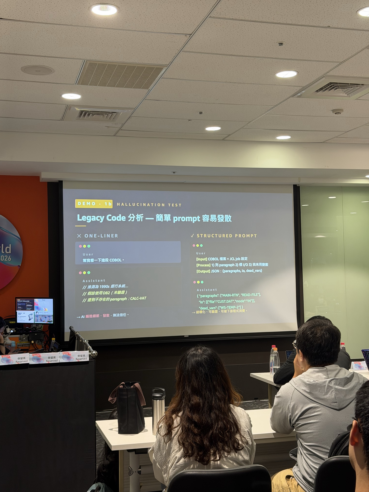

這張投影片具體呈現「模糊任務會讓模型自行補故事」與「指定輸入、處理步驟、輸出契約」的差異。

#### 詳細資料

[README](hello-world-notes/session/2026-10-15/1600-harness-engineering/README.md) · [notes](hello-world-notes/session/2026-10-15/1600-harness-engineering/notes.md)

### Lint + Architecture Test：Agentic Coding 防護牆

講師與時間：Neo Hsu，2026-10-15 17:00–17:30。

#### 核心觀念

Lint 檢查局部語法或直接依賴，Architecture Test 檢查整個 import／dependency graph 的邊界；兩者都應該成為 Agent 工作流的可執行 feedback，而不是只寫在 Prompt 裡。

#### 解決的問題與方法

筆記以 Go `depguard` 為例，透過 whitelist 限制直接依賴，要求 `nolint` 必須附理由。架構測試則要檢查完整路徑與方向，並測試 checker 自己：合法案例要過、違規要失敗、空掃描要失敗，還要確認 module、GOOS、build tags、generated code 與 test package 的範圍。

建議的三層護欄是 Agent 自我驗證 → Git Hook → CI + repository protection，而且盡量使用同一個 `make verify`。Agent 修復要有限次數，保留 stdout／stderr、lint message 與檔案路徑，避免模型在錯誤訊息被截斷後盲目重試。

#### 講者實戰經驗

現有筆記沒有本專案新增 lint 或 architecture test 的實作，因此這裡只記錄方法與待做 POC，不宣稱已經導入。

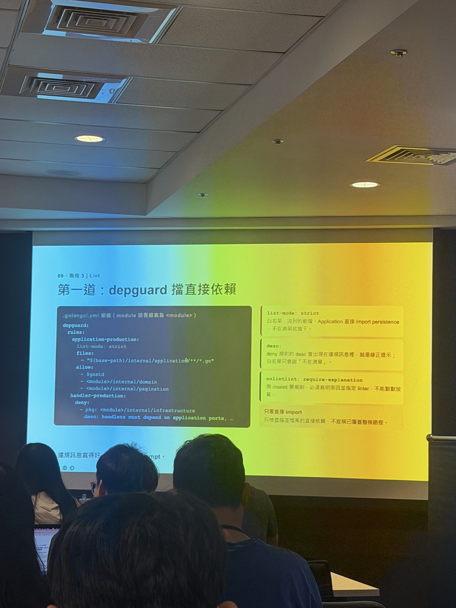

圖中可看到規則除了列出允許的 import，還要求違規說明與禁止無理由 `nolint`；這就是把架構意圖轉成機器可檢查的門檻。

#### 這堂值得帶走的東西

先把一條最重要的依賴規則做成失敗可讀、可重跑、可放進 CI 的檢查，再逐步把 Agent 修復迴圈接到同一個驗證命令；不要一開始就建立一整套抽象框架。

#### 詳細資料

[README](hello-world-notes/session/2026-10-15/1700-lint-architecture-test/README.md) · [notes](hello-world-notes/session/2026-10-15/1700-lint-architecture-test/notes.md)

## 這兩天實際留下的成果

| 課程 | Artifact／成果 | 狀態 | 重要價值 | 詳細連結 |
|---|---|---|---|---|
| Structurizr × OpenCode | `dev/structurizr/workspace.dsl`、`workspace.json`、`adrs/0001-reuse-existing-realname-app.md`、Makefile／Docker 執行環境 | **已完成（有範圍）**：DSL、ADR 與驗證紀錄存在；曾完成 `make validate`，部分 layout／完整檢查仍應以目前環境重跑 | 架構模型、決策與可產生圖的資料進入版本控制 | [dev](hello-world-notes/session/2026-10-14/1010-structurizr-opencode/dev/) · [notes](hello-world-notes/session/2026-10-14/1010-structurizr-opencode/notes.md) |
| 事件驅動交易 | 筆記中的外部案例、負載數字、reconciliation 與失敗分析；沒有本地 repo | **只有課程／案例筆記** | 具體示範效能與一致性取捨，不能視為本專案實驗 | [notes](hello-world-notes/session/2026-10-14/1330-event-driven-trading/notes.md) |
| LLM Wiki | Raw／Wiki／Ops 分層與小型問答回歸紀錄 | **只有課程／案例筆記** | 提供知識版本與品質回歸的設計方向，尚非本地 POC | [notes](hello-world-notes/session/2026-10-14/1330-llm-wiki/notes.md) |
| MCP OAuth2 Workshop | `repo/` 完整教材；現有筆記記錄 Lab 01–05 驗證，Lab 06 Gateway 尚待確認 | **部分完成** | 留下可重跑的 OAuth、PKCE、scope、audience、撤銷實驗 | [repo](hello-world-notes/session/2026-10-15/1300-mcp-oauth2-workshop/repo/) · [notes](hello-world-notes/session/2026-10-15/1300-mcp-oauth2-workshop/notes.md) |
| 其餘 Session | README、notes 與部分現場照片 | **只有課程素材／筆記** | 形成可回填的研究線索，沒有虛構成實作成果 | 對應上方課程連結 |

目前可明確列為「有本地 Artifact」的課程是 **2 場**：Structurizr × OpenCode 與 MCP OAuth2 Workshop。A2A／x402／AP2 與架構判斷新增了完整現場筆記與圖片，但仍屬課程理解與素材，不是本專案的實作 Artifact。事件驅動交易的數據、LLM Wiki 的評估數字與事故調查架構圖也都是課程／現場記錄，不是我在本專案中重新跑出的 benchmark。

## 對公司的應用建議

### 1. 先做 AI Coding 的驗證閘門 POC

- **可解決的問題：** Agent 產生的程式可能看似完成，卻違反依賴方向、測試範圍或安全規則。
- **方法：** 選一個專案，把 Build、Lint、Unit Test、Architecture Test、`git diff` 與必要的安全掃描串成單一 `verify` 命令，讓 Agent、Git Hook、CI 共用。
- **導入前確認：** 目前最重要的架構邊界、失敗訊息是否足夠具體、哪些變更必須人工核准。
- **預期效益：** 讓錯誤在早期被發現，並留下可比較的失敗證據。
- **風險／成本：** 初期規則維護與誤報成本；若規則過寬或只允許 Agent 自己修改，可能形成形式上的安全感。
- **建議：** **小型 POC**，對應團隊 AI Workflow、Agent Compliance、Harness、Lint 課程。

### 2. 對高風險 Agent 動作建立權限與審批邊界

- **可解決的問題：** Agent 誤 commit、跨環境部署、讀取敏感資料或觸發不可逆操作。
- **方法：** Skills 描述流程，pre-tool check 與權限實際阻擋；低風險可逆動作自動化，部署、資料刪除與跨系統操作保留人工確認。
- **導入前確認：** 需要哪些 allowlist、audit 欄位、沙盒模式與撤銷方式；先盤點真正的高風險動作，不假設公司目前沒有治理。
- **預期效益：** 把模型遵守規範的責任移到可驗證的系統控制。
- **風險／成本：** 流程可能變慢；權限過細會造成繞過機制，過寬則失去邊界。
- **建議：** **先研究，再挑一個工作流 POC**，對應 Agent Compliance、ACP 與 MCP OAuth2。

### 3. 建立事故調查的最小證據管線

- **可解決的問題：** Kubernetes 告警太多，工程師必須手動切換多個遙測來源才能形成假設。
- **方法：** Webhook 快速收件 → 背景 Worker → 規則縮小範圍 → Agent 依權限查 Metrics／Logs／Traces／events → 結構化報告與人工確認。
- **導入前確認：** 工具讀取權限、PII／secret 過濾、timeout、retry、idempotency、模型成本與 root-cause 的驗收標準。
- **預期效益：** 先減少取證與整理時間，而不是承諾模型自動做根因決策。
- **風險／成本：** 錯誤摘要可能造成誤判；歷史案例相似不代表當下根因；需要完整 trace 才能追責。
- **建議：** **小型 POC**，只產生證據摘要與待確認假設，不直接自動修復。

### 4. 用 Architecture as Code 與 ADR 管理 AI 參與的架構變更

- **可解決的問題：** Agent 改動後，團隊只看到 diff，不知道系統邊界與決策理由。
- **方法：** 先建立最小 C4／架構模型，將外部系統、責任與主要資料流版本化；重大取捨用 ADR 記錄。
- **導入前確認：** 模型維護責任、哪些層級值得建模、圖與程式碼如何在 CI 中驗證。
- **預期效益：** 新成員與 Agent 都有可檢視的共同上下文。
- **風險／成本：** 模型過細會變成維護負擔；圖好看不等於決策正確。
- **建議：** **直接在單一服務做小型 POC**，不要一次建完整企業架構。

### 5. 對知識問答與雲端成本先建立可追溯基準

- **可解決的問題：** RAG 回答退步或雲端成本上升時，團隊只能憑感覺判斷。
- **方法：** LLM Wiki 保留 Raw／結構化知識／Ops review；FinOps 保留成本歸屬、時間窗、基準與異常原因。
- **導入前確認：** 哪些資料可以進索引、誰負責 review、題庫與成本指標如何固定、個資與權限如何處理。
- **預期效益：** 答案品質與成本優化都有可回溯的證據。
- **風險／成本：** 建立資料治理與回歸題庫需要持續維護；單次準確率或一次節省數字容易被過度解讀。
- **建議：** **先研究／小型 POC**，待確認適用性，不把課程案例直接當公司成效。

## 個人學習收穫

- 我對 AI Coding 的理解從「怎麼讓模型產出更好的程式」轉成「怎麼設計一個可觀測、可驗證、可恢復的工作系統」。Harness 的六個面向讓現有的 AGENTS、Skills、Build、Test、CI 與 benchmark 可以放到同一個模型中檢查缺口。
- Structurizr 工作坊讓架構圖不再只是簡報輸出；DSL、ADR、驗證與 layout 都可以成為可 review 的工作物。下一步要注意模型的維護成本，不要為了圖而圖。
- 事件驅動交易課讓我更清楚看到效能數字不能脫離資料正確性。局部吞吐量變好、短測通過，仍可能在跨服務 reconciliation 或長測中失敗。
- MCP OAuth2 Workshop 把「安全連接工具」拆成可觀察的 HTTP 與 Token 邊界；未來設計 Agent／MCP 整合時，要先回答 issuer、audience、scope、resource、撤銷與資料隔離，而不是只看 client 是否顯示 connected。
- ACP 與 Harness 課程一起看，聊天介面只是外層；真正要設計的是 Session、Context、State、streaming event、權限與 recovery。這也適用於我自己的長任務與多 Agent 工作流。

## 後續行動

1. **完成一個 Agent 驗證閘門 POC。** 目標：選現有專案的一條重要依賴規則，最小行動：加入可讀的 lint／architecture check 與 `make verify`；驗證方式：合法與違規案例各一個，並確認 Agent 能讀到完整錯誤再有限次數修復。對應：Agent Compliance、Harness、Lint。
2. **把 Structurizr 與 ADR 重跑一次。** 目標：確認模型、驗證命令與 viewer 在目前環境可重現；最小行動：重新執行既有 Makefile／檢查並記錄差異；驗證方式：DSL、ADR、產出 JSON 與圖一致。對應：Structurizr Workshop。
3. **做 Alert → Rule → Agent → Report 的唯讀事故調查 POC。** 目標：減少取證整理時間；最小行動：只接一種告警、兩個遙測工具與結構化報告；驗證方式：用一個已知事件檢查證據完整度、耗時、成本與人工判斷是否仍正確。對應：AI Incident Investigation。
4. **整理一個可重跑的 MCP 授權驗證清單。** 目標：把 Lab 01–06 的結果與未完成項目分清楚；最小行動：補記 Lab 06 是否實際成功，避免提交 `.env`／Token；驗證方式：確認 401、PKCE、scope、audience、撤銷與 Gateway 行為都有對應輸出。對應：MCP OAuth2 Workshop。
5. **為自己的長任務補最小 Harness 記錄。** 目標：知道 Agent 失敗在 Prompt、Context、Tool 還是驗證；最小行動：保存任務輸入、工具事件、驗證結果與 recovery 決策；驗證方式：挑一次失敗任務重播並能說明失敗位置。對應：Harness、ACP、團隊 AI Workflow。

## 資料完整性與閱讀說明

- 本 Summary 收錄 **13 場課程**。
- 精選 **11 張圖片**：目前有素材的 12 場中，挑選 11 張放入 Summary；內容涵蓋 Structurizr、事件驅動交易、LLM Wiki、Agent Skills、FinOps、A2A、架構判斷、團隊 AI Workflow、事故調查、Harness 與 Lint。MCP OAuth2 的截圖因含帳號、Client ID、Token／授權流程或分享提示，不列入公開摘要；ACP 目前沒有 `assets/` 檔案可引用。
- 明確有本地 Artifact 的課程有 **2 場**：Structurizr × OpenCode、MCP OAuth2 Workshop；前者的 DSL／ADR／workspace JSON，後者的 `repo/` 與授權實驗筆記。
- A2A／x402／AP2、架構判斷已補上現場筆記與各自精選圖片；兩場仍沒有本地實作 Artifact，因此成果表維持「課程素材／筆記」，不誤寫成已完成實驗。
- 其他課程若只列「課程／案例筆記」，表示現有資料沒有本地實作或可重跑 Artifact；不代表課程沒有價值。

