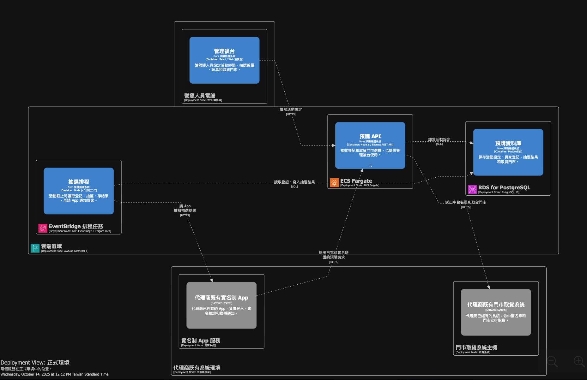

# Notes

> **參與狀態：未參加本場。** 以下內容是根據既有課程資料、實作目錄與素材整理的背景筆記，不代表我在現場聽到或完成了全部 Workshop。

這張是既有實作素材中的部署視角；可看到預購服務、抽選排程、資料庫，以及代理商既有 App／門市取貨系統的關係。它適合作為後續閱讀 DSL 與 ADR 的入口，不應解讀成我參與現場的證明。

## 一句話總結

- github: https://github.com/mansunkuo/hello-world-2026/tree/main
這堂課的核心不是安裝 OpenCode，也不是單純畫架構圖；而是用 Structurizr 的 **Models as Code** 加上 ADR，把架構、取捨與決策理由變成團隊和 AI 都能持續使用的共同基準。

## 課程主線

1. 架構師要對決策結果負責，並把技術選擇、商業目標和團隊協作連起來。
2. 在建模前先整理脈絡：功能需求、非功能需求、技術限制、既有系統與整合邊界。
3. 用 C4 模型逐層描述系統：System Context → Container → Component → Code。
4. 用 Structurizr DSL 保存一份可版本控制的架構模型，再從同一份模型產生不同溝通視角。
5. 用 OpenCode 以自然語言協作產生和修改模型，不需要先背熟 DSL。
6. 用 ADR 記錄「為什麼這樣設計」、考慮過哪些方案，以及決策帶來的後果。

## 為什麼要安裝這些

這些是課程的工作環境，不是課程本身的成果：

- **OpenCode**：用自然語言和 AI 協作架構建模。
- **Structurizr**：把 DSL 模型即時渲染成 C4 架構圖。
- **Docker**：啟動 Structurizr 的本機檢視器。
- **Structurizr MCP**：讓 OpenCode 更能理解和檢查 Structurizr 模型。
- **VS Code / 擴充套件**：編輯 DSL、查看語法、開啟 OpenCode 對話介面。

如果環境裝不起來，也可以用 Structurizr Playground 搭配 ChatGPT、Claude 或 Gemini 體驗核心流程。

## 實作題目：Toy Preorder Lottery Service

要替一個 agent 建立低成本的玩具預購抽籤服務。既有系統已經有：

- Real-name verification app：買家登入並完成實名驗證
- Store system：得獎者選擇取貨門市

這次只需要新增預購抽籤能力，不要重做買家 App，也不要重做門市系統。

功能範圍：

- 操作者設定預購活動期間與每位買家可登記的總數量
- 買家在活動期間登記想要的商品
- 活動結束後抽籤產生得獎者
- 得獎者選擇取貨門市

## 我應該怎麼做

先不要急著寫 DSL，依序整理：

1. 系統邊界：哪些是我們要建的，哪些是既有外部系統。
2. System Context：誰使用這個服務？它和哪些系統互動？
3. Container：預購、登記、抽籤、通知、資料儲存各自負責什麼？
4. 關係與限制：資料如何流動？活動結束和抽籤有哪些規則？
5. 重要決策：哪些地方有多種做法，需要留下取捨？
6. 驗證與溝通：用圖和檢查結果確認不同角色看到的是同一個模型。

## ADR 筆記格式

每個重要決策記四件事：

- **Context**：遇到什麼問題或限制？
- **Options**：考慮過哪些替代方案？各自優缺點是什麼？
- **Decision**：最後選了什麼？
- **Consequences**：因此變容易和變困難的是什麼？

## 架構師的重點提醒

- 架構不是只畫圖，而是建立跨角色的共同理解。
- 透明說明 trade-off，比只宣布答案更能建立信任。
- 架構決策如果沒有留下「為什麼」，團隊換人、系統變大或時間拉長後就會失去脈絡。
- 軟體架構的一切都是取捨；`why` 通常比 `how` 更值得留下來。

## 課程成果

- [ ] 一份玩具預購抽籤服務的 `workspace.dsl`
- [ ] System Context 與 Container 視角
- [ ] 至少一份有替代方案與後果的 ADR
- [ ] 一份可以交給團隊和 AI 繼續使用的架構基準

## 我實際完成的環境

- OpenCode V2 `2.0.28`
- Structurizr MCP：`connected`
- Docker image：`structurizr/structurizr:latest`
- VS Code：OpenChamber、Structurizr DSL extensions

## 回家後練習

- [ ] 把玩具預購題目完成成自己的 C4 模型
- [ ] 為一個有爭議的設計選擇寫 ADR
- [ ] 把同一份模型改成主管、工程師、維運人員的不同視角
- [ ] 用自己的專案重跑一次「脈絡 → 模型 → 圖 → ADR」流程
