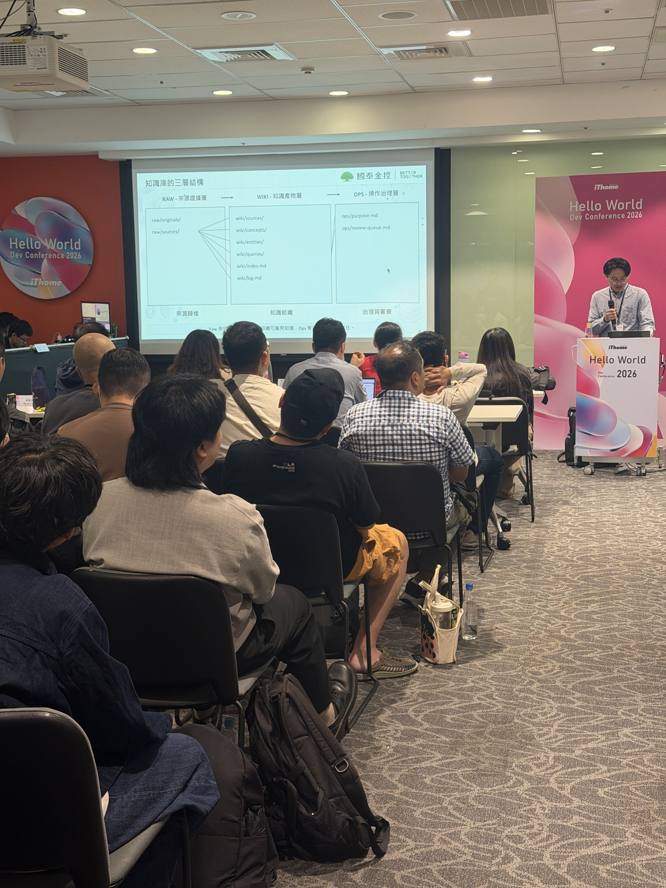

# Notes — LLM Wiki：企業內部知識問答系統的架構演進

**講者**：張維峻（Justin）｜國泰金控  
**日期**：2026-10-14 13:30–14:00



這張簡報直接畫出 Raw、Wiki、Ops 三層：先保留原始證據，再整理成可查詢的知識，最後由 Ops 管理更新、審查與發布。它比單純展示課程標題更能說明 LLM Wiki 的核心設計。

## 一句話總結

企業 RAG 的瓶頸不只是檢索能力，而是**原始知識缺乏結構、版本管理與驗證機制**。LLM Wiki 將知識整理提前到文件更新階段，讓 Agent 更容易理解、引用及維護知識。

## 現場重點

### 1. 從 Agentic RAG 到 LLM Wiki

原本使用 LangGraph 建立 Agentic RAG，但遇到：

- 新舊規範難以判斷適用情境。
- 文件更新後，相關知識不一定同步更新。
- 來源引用不穩、回答難以除錯。

**Knowledge Compilation**：來源更新時，先整理規則、適用條件與來源依據，而不是每次提問都重新讓 LLM 解讀所有文件。可以與 RAG 搭配，並非完全取代 RAG。

### 2. 知識庫三層架構

```text
Raw — 原始證據
├── originals/
└── sources/
       ↓
Wiki — 結構化知識
├── sources/
├── concepts/
├── entities/
└── queries/
       ↓
Ops — 維護與治理
├── purpose.md
└── review-queue.md
```

- **Raw**：保留原始文件，確保可追溯。
- **Wiki**：整理共通規則、實體及問題對應知識。
- **Ops**：控制知識更新、審查與發布。

我的筆記：`Raw Doc → 整理後的知識 → Embedding`，但原始與整理後的文件都要保留。Embedding 是可搭配的檢索手段，不是三層架構的必要步驟。

### 3. 知識更新流程

`Compile → Validate → Review → Publish`

- **Compile**：分析新舊文件差異及受影響知識。
- **Validate**：驗證修改正確、不相關內容未受影響，並測試實際回答。
- **Review**：人工確認來源、差異與測試結果後發布。

重點：**文件沒有被修改，不代表模型回答沒有退步。**

### 4. 評測與實際結果

使用合成企業規範案例，先定義評測標準，再讓模型回答。

| 測試 | 結果 |
|---|---|
| v1：10 題 Baseline | 8/10 |
| v2：11 題 Baseline | 10/11 |
| v2：首次更新 | 9/11 |
| v2：修復後同題重測 | 11/11 |

首次更新後，部分回答漏掉適用資格、生效日期或失敗時的退路。

修訂 `ops/purpose.md` 回答規則後，同題重測全部通過。

**限制**：v1、v2 測試條件不同，不能直接比較；11/11 不代表整體準確率，也尚未通過獨立未見題驗證。

## 新學到的觀念

- **知識更新也是工程變更**：需要版本、來源依據、影響分析、回歸測試及人工審查。
- **最新文件不一定全面取代舊文件**：必須判斷適用資格、生效時間與例外條件。
- **檢索正確不代表回答正確**：還要驗證最終回答是否完整、引用是否有效。
- **Model Judge 也可能誤判**：不能只依賴自動評分結果。

## 我的想法／公司應用

目前 Geo RAG 主要透過文件切塊、Embedding、Qdrant 檢索與 LLM 生成答案。

可以研究是否補強：

1. **Source → Knowledge**：保留原始文件，另外整理重要業務規則及適用條件。
2. **Version / Effective Date**：處理新舊法規、函令的適用範圍。
3. **Knowledge Change PR**：來源更新後，執行影響分析、回答回歸測試及審查。

不建議立即重建整套 RAG。先挑選少量具有版本差異的文件做 POC，確認是否改善回答品質，以及額外維護成本是否值得。

## 後續行動

- [ ] 研究 LLM Wiki / Knowledge Compilation 的實際實作方式。
- [ ] 比較 Geo RAG 現有資料流程與 Raw / Wiki / Ops 架構。
- [ ] 設計新舊法規適用條件的固定評測題。
- [ ] 評估小型 Knowledge Change PR POC。

## 素材

- `assets/IMG_7835.jpeg` — 課程開場
- `assets/IMG_7836.jpeg` — Raw / Wiki / Ops 架構
- `assets/IMG_7837.jpeg` — 6 份來源、18 頁草稿、17 項主張、10 題評測
- [Hello World 2026 共筆](https://hackmd.io/@HWDC/2026)
