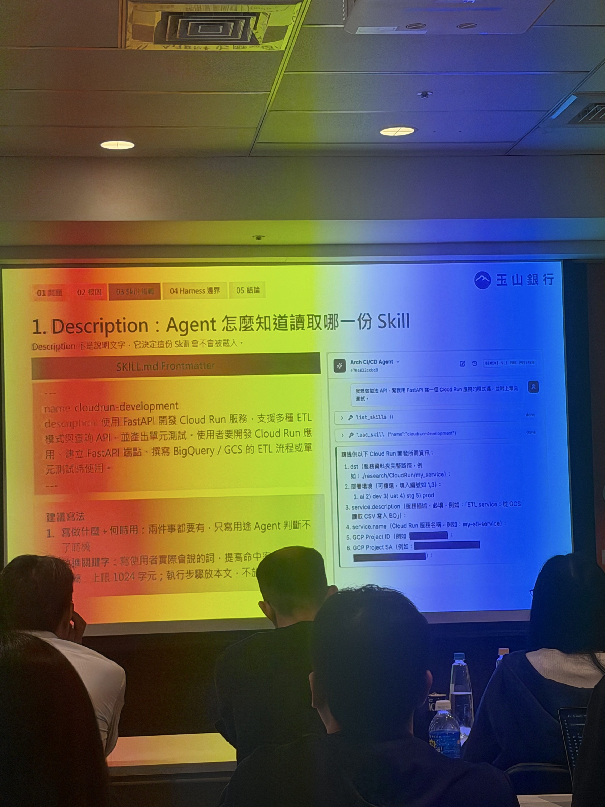

# Notes

圖中示範以 `SKILL.md`、description 與 Agent 讀取 Skill 的方式拆分責任，重點不是把所有規則塞進一份巨大 Prompt。

## 一句話總結

**AI Agent 不能只靠 Prompt 或 LLM 自律來遵守開發規範，而應將規範拆成 Skills，並透過 Harness、權限與執行前檢查建立強制約束，讓 AI 能在安全邊界內完成開發與部署。**

## 現場重點

### 1. Skills 拆分與責任分離

- 將開發流程拆成不同職責的 Skills，而不是將所有規範集中在單一 Prompt。
- 開發與部署應區分責任，避免 Agent 擁有不必要的操作權限。
- 規範應在 Agent 執行任務時就介入，而不是等到產出完成後才檢查。

### 2. 不同層級的限制與約束

- Agent 的行為需要多種限制機制共同約束。
- LLM 有可能理解錯誤、忽略規則，甚至執行不符合預期的操作。
- 最後需要由 Harness（Agent 執行框架）實際執行限制，而不是完全相信模型。

根據官方課程介紹，相關機制包括：

- **Skills**：將領域知識與開發規範轉換成可重複使用的能力。
- **Permission System**：限制 Agent 能執行哪些操作。
- **Pre-tool Hook**：在工具執行前進行檢查與攔截。
- **Human Approval**：對不可逆或跨越信任邊界的操作保留人工確認。

### 3. 機敏資料保護

現場提出的重要問題：

**Agent 在讀取、修改或提交程式碼時，要如何避免機敏資料外洩？**

需要特別關注：

- 程式碼與設定檔是否包含機敏資料。
- Agent 是否可能把 Secret 寫入程式碼或提交紀錄。
- 敏感操作能否透過權限與 Hook 阻擋。
- 哪些檢查應在 Agent 執行前、提交前或部署前進行。

具體使用哪一種機敏資料掃描工具，目前現場筆記尚未記錄。

### 4. 讓異常變成下一次的經驗

- 每次 Agent 發生錯誤或異常，都應該成為後續改善的依據。
- 不應只修正當下結果，還需要判斷是否能透過規則或框架避免再次發生。
- 將已知失敗模式轉化為可重複執行的檢查機制。

## 新學到的觀念

### LLM 的規則遵循不等於安全保證

即使已經在 Prompt 或 Skills 中定義規範，也不代表 Agent 一定會遵守。

可以將約束分成兩層：

**Soft Constraints（軟性約束）**
- Prompt
- Rules
- Skills
- 開發規範文件

**Enforced Constraints（強制約束）**
- Permission
- Pre-tool Hook
- 自動化檢查
- 人工審核

核心差異是：前者告訴 Agent 應該怎麼做，後者決定哪些操作實際可以被執行。

## 講者的實務經驗／踩坑

### 1. Agent 可能自行執行不預期操作

現場提到 LLM 可能出錯，甚至自行執行 Commit 等操作。

因此，需要避免 Agent 在沒有適當控制的情況下，自行執行高風險動作。

### 2. 不能只依賴模型遵守規則

即使事先制定開發規範，執行結果仍可能偏離預期。

因此，安全與合規要求需要透過框架機制落實。

### 3. 錯誤應回饋到工作流程

發生異常後，不應只修補單次結果，而應將問題轉換成後續可執行的限制或檢查。

## 我的想法

這場最值得注意的不是如何建立更多 Skills，而是：

**Skills 負責描述能力與規範，Harness 負責落實執行邊界。**

尤其在使用 Codex、OpenCode 等 Coding Agent 時，Prompt 寫得再完整，也不應等同於已經具備安全控制。

另一個值得深入的方向是機敏資料保護：不只防止程式碼出錯，也需要避免 AI 開發過程將 Secret、Token 或其他機敏資訊帶入不適當的輸出及提交紀錄。

## 對公司可能有用的地方

### Agent Coding 安全治理

可評估將既有 AI Coding 開發流程加入：

- Skills 職責拆分。
- 權限與工具執行限制。
- 機敏資料掃描。
- Commit / Push / Deploy 等操作的核准邊界。
- 失敗案例回饋機制。

**目前屬於可評估方向，不代表公司現有流程缺少這些能力，也不建議未盤點就直接導入。**

## 個人可以應用的地方

### Ponytail 與 Agent Skills

目前已經有 Ponytail 等 AI Coding 規則，可以進一步思考：

1. 哪些規則只需要寫在 Prompt 或 Skills？
2. 哪些規則必須由工具強制執行？
3. 哪些操作需要人類核准？
4. 哪些常見錯誤可以轉換成自動化檢查？

重點不是增加更多規則文字，而是讓真正重要的限制能被執行與驗證。

## 後續研究／行動

- [ ] 研究 Agent Permission 與 Pre-tool Hook 的實際運作。
- [ ] 比較 Codex、Claude Code、OpenCode 支援的工具權限與執行限制。
- [ ] 研究 Secret Scanning 的工具與適用範圍。
- [ ] 定義 Commit、Push、Deploy 等操作的安全邊界。
- [ ] 從既有 Agent 開發錯誤中挑選一個案例，嘗試轉換成自動化檢查。
- [ ] 評估是否有必要將 Ponytail 中的重要限制落實為可執行的 Gate。

## 素材與參考連結

- 課程：懂行規的 Agent：把規範變成技能，自動化開發到部署
- 講師：張云姵（Sarah）
- 公司：玉山銀行
- 時間：2026-10-14 14:15–15:00
- 類型：Session

## 一句話結論

**AI Agent 的安全性不應只建立在「模型知道規則」之上，而應建立在「即使模型出錯，框架仍能限制危險操作」的工程機制上。**
