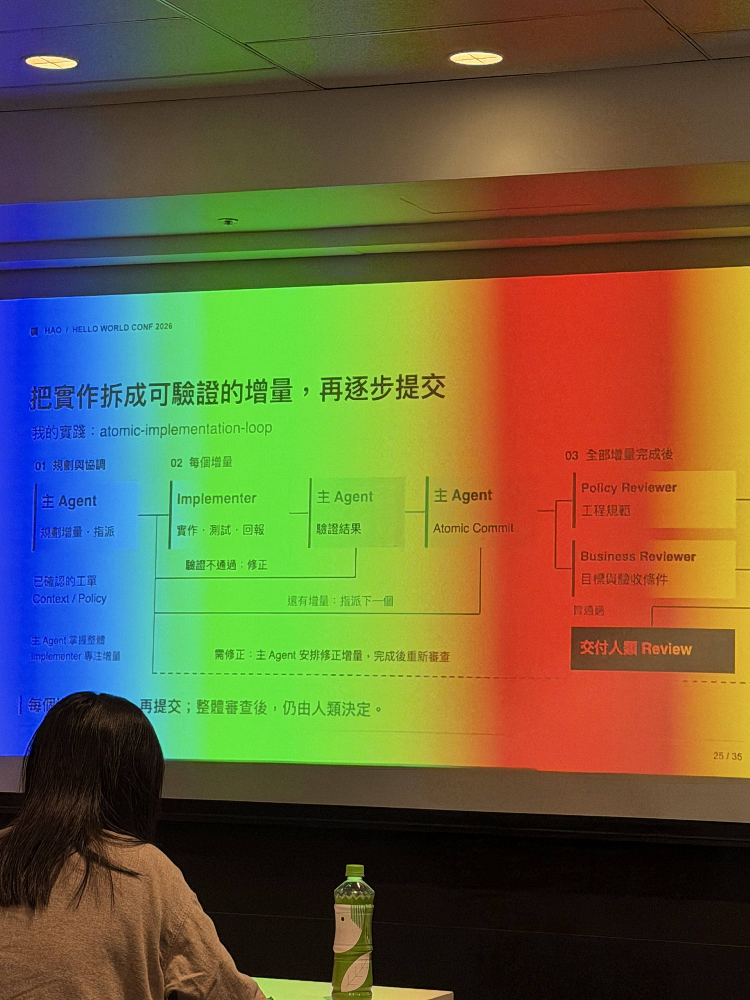

# Notes｜從一人 AI 工作流到團隊工程系統

- **日期**：2026/10/15 10:10–10:55
- **講師**：謝浩哲（HAO）｜TSMC Senior IT Engineer

這張投影片把團隊 AI 工作流畫成增量交付：主 Agent 規劃、Implementer 實作與測試、主 Agent 驗證，再由 Policy Reviewer、Business Reviewer 與人類完成審查。

## 一句話總結

AI 能加快程式碼產出，但不能保證品質。真正重要的是把**需求、規則、驗證與審查建立成可重複執行的工程流程**，並逐步轉化為團隊共享資產。

## 1. 先建立需求共識

不要直接讓 Agent 開始寫程式。

- 明確定義 Background、Goal、Non-goal、Acceptance Criteria。
- 使用 Domain、ADR、Decision Record 保存共同語言與設計理由。
- 將需求拆成可驗收的小工作項目。
- 可參考 `superpowers-brainstorming`、`writing-plans`、`grill-with-docs` 等 Skill。

## 2. 將工程規範變成可執行的檢查

AI 不一定遵守 `AGENTS.md` 或其他 Policy，因此不能只依賴提示詞。

| 機制 | 責任 |
|---|---|
| Policy | 定義專案特有的工程規則 |
| Skill | 封裝可重複的工作方法 |
| Tool | 用 Linter、Dependency Checker 等進行確定性檢查 |
| Agent | 執行具備明確職責的審查與驗證 |
| Human | 判斷商業需求、架構取捨與風險接受 |

**優先從 Linter、Git Hooks、CI 開始。** 本機檢查可能被繞過，因此 CI 必須再次檢查。

## 3. Atomic Implementation Loop

將大型任務拆成可驗證的小增量：

1. Meta-Agent 規劃與拆單。
2. Implementer 實作、測試、回報。
3. Meta-Agent 驗證結果，未通過就要求修正。
4. 通過後建立 Atomic Commit。
5. Policy Reviewer 檢查工程規範。
6. Business Reviewer 檢查需求與驗收條件。
7. 最後交由人類 Review。

**Commit 失敗也是回饋**：例如 Git Hook 阻止違反架構規則的提交，Agent 必須修正並重新驗證。

## 4. AI Review 不等於 PR 通過

- 測試通過不代表符合真正需求，AI 產生的測試也需要 Review。
- Reviewer Agent 必須具備足夠的 Context、Policy 與驗收條件。
- 人類仍負責最終決策與風險接受。
- Reviewer 是否能直接修正程式碼，可依流程設計；修改必須保留可追溯性與最終人工審查。

## 5. 從個人工作流推廣到團隊

- 專案特殊規則留在專案內。
- 跨團隊共用的 Policy、Skill 可封裝成 Package 或 Library。
- 先在單一專案驗證有效，再逐步推廣。
- 不需要一次建立完整的 Agent 系統。

講者建議從最近一次「怎麼又犯同樣的錯」開始改善。

## 我的收穫與後續

- [ ] 檢查現有 `AGENTS.md`／Ponytail 中哪些規則可以轉成 Linter 或 Architecture Test。
- [ ] 研究 Atomic Implementation Loop 是否適合現有 Codex 工作流。
- [ ] 把 Acceptance Criteria 提前到工作項目建立階段。
- [ ] 比較 Reviewer Agent 只提出建議與直接修正、Commit 的優缺點。
- [ ] 評估團隊共用 Policy／Skill 的管理方式。

## 核心結論

**AI 不會替團隊創造工程紀律；工程師必須把紀律設計成 AI 也能參與、執行與接受驗證的流程。**

參考：[Hello World Dev Conf 2026 共筆](https://hackmd.io/@HWDC/2026)
