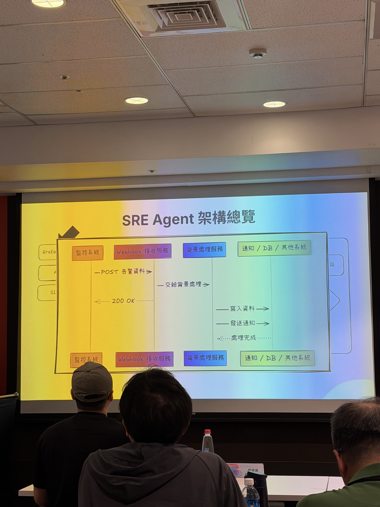

# Notes

**課程：** 當 AI 開始調查事故：讓 Kubernetes 告警從噪音變決策  
**講師：** Duo（大型電商 Senior Engineer）  
**日期：** 2026-10-15 11:15–12:00  



圖中可看到監控系統、Webhook 接收服務、背景處理服務與通知／資料儲存之間的責任分離。
**地點：** A 會議室

## 一句話總結

傳統 SRE 收到告警後，需要人工跨 Grafana、Metrics、Traces、Logs、Kubernetes Events 與程式設定尋找問題根因。這場分享將這段調查工作轉換成 **Alert → 自動蒐集證據 → SRE Agent 分析 → 結構化結果 → 通知與保存** 的流程，讓 AI 負責整理線索，工程師負責最終判斷。

## 1. 傳統 SRE 的事故調查流程

第一張投影片：「人類工程師」如何工作。

```text
收到 Alert
    ↓
打開 Grafana
    ↓
查看 Metrics
    ↓
查看 Traces
    ↓
查看 Logs
    ↓
產生懷疑
    ↓
檢查其他部分
    ↓
查 AP Config / 程式碼異動
    ↓
檢查外部依賴
    ↓
逐漸縮小問題範圍
    └─ 證據不足時，重新調查
```

主要問題：

- 系統已經提供大量可觀測性資料，但沒有直接給出事故根因。
- 工程師需要人工切換多個工具，拼湊分散的證據。
- 排查是一個反覆建立假設、驗證假設的循環。
- 調查過程依賴工程師的系統知識與經驗。

**核心觀念：Observability 不等於 Diagnosis。**

Metrics、Logs、Traces 能告訴你系統發生了什麼，但不一定能直接回答為什麼發生。

## 2. SRE Agent 系統架構

第二張投影片：「SRE Agent 架構總覽」。

系統拆成四個主要部分：

| 元件 | 責任 |
|---|---|
| 監控系統 | 偵測異常，產生告警 |
| Webhook 接收服務 | 接收告警，快速回應 |
| 背景處理服務 | 非同步執行調查任務、寫入資料與通知 |
| 通知／DB／其他系統 | 保存調查結果與通知相關人員 |

資料流程：

```text
Grafana / Alerting System
          ↓
      告警觸發
          ↓
Webhook Receiver
          │
          ├─ 接收 POST 告警資料
          ├─ 回傳 200 OK
          └─ 將任務交給背景處理
                       ↓
               Background Worker
                       │
                       ├─ 呼叫 SRE Agent
                       ├─ 收集調查結果
                       ├─ 寫入資料庫
                       └─ 發送通知
```

**架構重點：Webhook 接收與實際調查分離。**

Webhook 負責快速接收事件；長時間的調查工作交給背景處理服務，避免告警來源等待整段 AI 分析。

投影片呈現這個非同步責任分離概念，沒有進一步提供 Queue、Retry、Timeout、Idempotency 等實際實作細節。

## 3. Agent 的內部工作流程

第三張投影片：「SRE Agent 架構總覽」。

```text
排程觸發
    ↓
建立檢查任務
    ↓
載入本次檢查指令
    ↓
選擇工具
    ↓
呼叫工具
    ↓
取得結果
    ↓
是否需要再查資料？
    ├─ 是 → 選擇下一個工具
    │          ↓
    │       繼續調查
    │
    └─ 否
         ↓
    判斷本次是否通過
         ↓
    ┌────┴────┐
    │         │
   通過     不通過
    │         │
保存結果   發送通知
    │
   結束
```

這套 Agent 不是單次 Prompt 問答，而是具備多輪工具使用能力的調查流程。

核心設計：

- 每次調查從具體的檢查任務開始。
- Agent 依任務選擇適合的資料查詢工具。
- 工具回傳資料後，再判斷是否需要進一步調查。
- 直到能夠依檢查條件判斷結果，才完成任務。
- 調查結果後續可以用於通知、保存與其他系統整合。

官方介紹強調：**AI 不應直接收到原始告警就自由猜測，而要先由規則建立調查上下文。**

## 4. 為什麼需要規則引擎？

如果把 Alert 原文直接丟給 LLM，可能出現：

- 缺少系統脈絡
- 不清楚要檢查哪些服務
- 不知道哪些指標能支持結論
- Agent 自行猜測根因
- 相同告警產生不同調查結果

因此需要在 AI 分析前建立調查規則。

概念流程：

```text
Alert
  ↓
規則／檢查任務
  ↓
整理調查上下文
  ↓
指定可使用的工具
  ↓
Agent 收集證據
  ↓
結構化分析結果
```

這部分是官方演講描述的設計原則；投影片沒有展示規則引擎的具體 DSL、程式實作或 Rule Schema。

## 5. SRE Agent 成功率與單次 RC 成本

第四、五張投影片比較不同模型執行 SRE Agent 任務的成功率與單次 RC 成本。

第四張比較 4 月與 10 月的結果：

| 模型 | 4 月成功率 | 10 月成功率 | 4 月單次成本 | 10 月單次成本 |
|---|---:|---:|---:|---:|
| opus-5.5 | 93% | — | $0.69 | — |
| gpt-6-astra | 93% | — | $3.14 | — |
| gpt-6.1-sol | 92% | — | $0.43 | — |
| sonnet-5.5 | 87% | — | $0.34 | — |
| opus-4.6 | — | 85% | — | $1.44 |
| gpt-5.4 | — | 82% | — | $0.96 |
| gpt-6-luna | 79% | — | $0.11 | — |
| qwen3.8-27b | 78% | — | $0.014 | — |
| gpt-5.3-codex | — | 73% | — | $0.72 |
| sonnet（版本未完整辨識） | — | 70% | — | $1.01 |

第五張則比較兩種推理等級：「預設」與「最高思考」。

| 模型 | 預設成功率／成本 | 最高思考成功率／成本 |
|---|---|---|
| opus-5.5 | 93% / $0.69 | 96% / $3.08 |
| gpt-6-astra | 93% / $3.14 | 95% / $6.65 |
| gpt-6.1-sol | 92% / $0.43 | 94% / $1.47 |
| sonnet-5.5 | 87% / $0.34 | 96% / $4.39 |
| gpt-6-luna | 79% / $0.11 | 84% / $0.39 |
| qwen3.8-27b | 78% / $0.014 | 81% / $0.018 |

**重要觀察：**

- 模型越貴，不代表成功率一定越高。
- 較高推理等級可能提升成功率，但成本也可能大幅增加。
- 不同模型在特定 SRE Agent 任務上存在明顯的成本效益差異。
- 應依照任務成功率與成本進行選型，而非只看模型排名。

**資料限制：** 數字依現場照片整理，部分模型名稱和版本可能因投影清晰度而有誤。照片沒有完整展示 RC 的定義、測試樣本數、成功判準、幣別與測試環境，因此不能把這份數據視為通用模型 Benchmark。

## 6. 歷史事故知識庫

官方介紹還提到，會將歷史事故轉成可搜尋的知識。

```text
過去的事故
    ↓
調查過程與結果
    ↓
歷史事故知識庫
    ↓
向量搜尋
    ↓
找出相似事故
    ↓
提供本次 Agent 調查參考
```

例如遇到相似的告警時，系統可以尋找過去有沒有發生過相近事件，協助工程師快速建立排查方向。

這不是取代即時 Metrics / Logs，而是補充既有事故經驗。

## 7. 我的技術理解與想法

以下是依照這場內容做的個人延伸，不代表講者已實作或驗證。

### 與現有 Host Inventory / AI Loop 的關係

兩者都有相似的決策結構：

```text
取得 Evidence
    ↓
判斷目前 Unknown
    ↓
選擇下一個工具／調查 Branch
    ↓
取得更多 Evidence
    ↓
重新判斷
    ↓
收斂結論
```

差異是 Host Inventory 偏向建立主機現況與架構證據；SRE Agent 則以正在發生的事故為起點，追求快速定位問題。

### 對公司可能有用的地方

可以評估在現有 Grafana、Logs、主機與應用監控之上，建立小型 AI Incident Investigation POC。

初期不需要讓 AI 自動修復 Production。

先驗證：

1. 能否根據特定 Alert 自動收集足夠證據。
2. 能否正確定位相關服務與異常時間範圍。
3. 能否產生附有證據來源的調查結果。
4. 是否真的比人工調查節省時間。
5. 調查成本與模型選型是否合理。

### 我自己可以延伸研究

- Alert 與調查任務的 Schema 設計
- Agent Tool Selection
- Structured Incident Report
- Historical Incident Retrieval
- Root Cause Evaluation
- Model Success Rate / Cost Benchmark

## 8. 尚未確認的技術細節

以下內容在目前提供的投影片中尚未看到完整說明：

- SRE Agent 實際使用的框架
- 工具呼叫協定
- 規則引擎如何定義檢查任務
- Agent 循環次數與停止條件
- 超時、重試與錯誤恢復策略
- Root Cause 正確性的人工驗證方法
- 模型 Benchmark 的資料集與成功判準
- 歷史事故向量資料庫的實際選型

後續如果拿到講者投影片或 Repo，可以再補充。

## 9. 後續行動

- [ ] 保存五張投影片照片到 `assets/`
- [ ] 確認講者是否有公開 SRE Agent 架構或範例 Repo
- [ ] 研究 Alert → Rule → Agent → Report 的最小 POC
- [ ] 比較不同模型的成功率、推理成本與延遲
- [ ] 評估公司現有監控是否具備必要的資料與查詢介面

## 最後結論

這場課最值得帶走的不是某個 Agent Framework，而是：

**可觀測性提供證據，規則建立上下文，Agent 負責調查，結構化結果讓人能驗證和做決策。**

AI 應該先協助工程師調查事故，而不是一開始就取得自動修復正式環境的權限。
