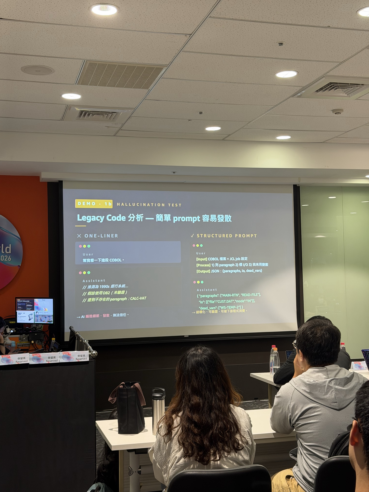

# 同一個 Prompt 為什麼差這麼多？——從踩坑到 Harness Engineering

## 一句話總結

AI 不穩定，問題不一定在 Prompt。



投影片對比模糊的一句話與指定 Input、Process、Output schema 的差異。

- **Prompt** 決定 AI 怎麼說
- **Context** 決定 AI 看得到什麼
- **Harness** 決定 AI 能做什麼、怎麼被控制、做錯後怎麼驗證與恢復

這堂課真正強調的是：

> AI 要進入正式工程流程，不能只靠「把 Prompt 寫好」，外面還需要一層可控制、可觀測、可驗證、可恢復的 Harness。

---

## 案例 1：Legacy Code 分析，簡單 Prompt 很容易發散

講者用 COBOL Legacy Code 做 Hallucination Test。

### One-liner

類似：

> 幫我看一下這段 COBOL。

AI 開始自行補故事：

- 推測是 1990s 銀行系統
- 猜可能使用 DB2，但沒有證據
- 提到原始程式中不存在的 paragraph
- 混入沒有根據的推論

問題不是 AI 完全不會分析，而是：

> 任務邊界太模糊，模型不知道哪些東西可以推測、哪些不可以。

### Structured Prompt

改成明確定義：

- **Input**：COBOL 檔案、JCL Job 設定
- **Process**：
  1. 列出 paragraph
  2. 整理 I/O
  3. 找未使用變數
- **Output**：固定 JSON schema

例如：

```json
{
  "paragraphs": ["MAIN-RTN", "READ-FILE"],
  "io": {
    "file": "CUST.DAT",
    "mode": "IN"
  },
  "dead_vars": ["WS-TEMP-2"]
}
```

### 這個案例真正強調的事情

不是「Prompt 寫越長越好」。

而是建立：

```text
Input
↓
Process / Constraints
↓
Output Contract
```

這樣 AI 的輸出才比較容易：

- 驗證
- 比較
- 串接後續程式
- 找出錯誤

對 AI Coding 也一樣。

不要只說：

> 幫我重構這個專案。

應該逐漸變成：

```text
Input
指定 repo / files

Process
只能修改 X
不能修改 Y
必須沿用既有 architecture

Output
修改檔案
測試結果
變更說明

Verification
TypeScript check
Unit test
Architecture test
git diff check
```

Structured Prompt 本質上開始接近一種 **Engineering Contract**。

---

## 案例 2：Context 給對了，Agent 還是可能失敗

講者強調一個很重要的現象：

> 同樣 Input、同樣 Context，執行三次，結果還是可能不同。

### Run 1

- Plan 成功
- Retrieve docs 成功
- Tool call 成功
- Final answer 成功

### Run 2

- Plan 成功
- Retrieve docs 成功
- Tool timeout
- Answer 不完整

### Run 3

- Plan 成功
- 找錯文件
- 回答 hallucination
- 沒有 trace，無法 Debug

這說明：

> **Context Engineering 不是終點。**

Context 可以讓 AI 比較有機會看到正確資訊，但沒有保證：

- Tool 一定成功
- 執行流程一定正確
- 結果一定可以驗證
- 失敗時一定知道原因
- 下一步一定能恢復

這就是為什麼要往 Harness Engineering 走。

---

# AI Engineering 的三層心智模型

## Layer 1：Prompt

解決：

> AI 要做什麼？

重點：

- Structured Input
- Structured Output
- Logic
- Process
- 明確限制

Prompt 主要控制：

> **AI 怎麼說。**

---

## Layer 2：Context

解決：

> AI 現在應該知道什麼？

包含：

- RAG
- MCP
- Skills
- Agents
- Multi-Agent
- Memory

Context 主要控制：

> **AI 看得到什麼。**

---

## Layer 3：Harness

解決：

> AI 要怎麼穩定、安全地完成任務？

包含：

- Orchestration
- Evaluation
- Observability
- Recovery

Harness 主要控制：

> **AI 能做什麼，以及做錯了怎麼辦。**

---

# Multi-Agent：重點不是 Agent 越多越好

講者把 Multi-Agent 拆成明確責任：

```text
               Orchestrator
             routes & coordinates
                    │
       ┌────────────┼────────────┐
       ▼            ▼            ▼
 Researcher      Builder      Reviewer
 gather facts    solution     verify
 retrieval       tools        test
       │            │            │
       └────────────┼────────────┘
                    ▼
       Shared Context / Memory / Outputs
```

### Researcher

負責：

- 找資料
- Retrieval
- 建立事實基礎

### Builder

負責：

- 建立 Solution
- 使用 Tools
- 實際執行

### Reviewer

負責：

- Verify
- Critique
- Test

### Orchestrator

負責：

- Routing
- Coordination
- 決定誰做下一步

真正重要的不是 Agent 數量，而是：

- Responsibility Boundary
- Shared Context
- Memory
- Output Contract
- Orchestration

如果只是多個 Agent 拿同一坨 Context，各自呼叫 LLM，沒有明確分工與驗證，其實只是「多次 LLM Call」，不是真正的 Multi-Agent Engineering。

---

# Harness 的六大核心

## 1. Prompt & Context

提供：

- 任務
- 背景
- 限制
- 當下需要的資訊

回答：

> AI 現在知道什麼？

---

## 2. Tool System

定義 Agent 可以碰哪些工具。

例如：

- API
- MCP
- CLI
- Browser
- Database
- Code tools

回答：

> AI 被允許做什麼？

---

## 3. Orchestration

控制執行流程：

- Routing
- 任務拆解
- Agent 分工
- Retry
- Timeout
- 執行順序

回答：

> AI 的工作怎麼被安排？

---

## 4. State & Memory

讓 AI 記得：

- 現在做到哪裡
- 前面做過什麼
- 過去任務發生什麼
- 哪些資訊需要延續

### Short-term Memory

記錄目前任務的資訊與狀態。

### Long-term Memory

記錄跨任務的資訊、歷史狀態與累積經驗。

### Execution Status

記錄任務目前執行進度與相關資料。

重點不是把全部聊天紀錄塞回 Prompt，而是：

> 有意識地保存任務真正需要延續的狀態。

---

## 5. Observability

Agent 做錯時，不能只看到：

```text
Failed
```

需要可以追整個任務。

講者列出的觀測單位：

### Sessions

任務的完整上下文脈絡。

### Traces

一次 request-response 的完整執行路徑。

### Spans

每個 operation 的起訖與狀態。

### Metrics

例如：

- latency
- token usage
- error rate
- cost

### Logs

執行細節與錯誤紀錄。

真正目的：

> Agent 出問題時，可以知道是 Prompt、Context、Tool、Orchestration，還是哪一步真的壞掉。

---

## 6. Verify & Recover

這是 Harness 最重要的一層。

### Verification

用較確定性的方式檢查結果：

- Unit Test
- Integration Test
- Schema Validation
- Rule Validation
- Architecture Test

### Evaluation

判斷品質：

- LLM-as-a-Judge
- Score
- Rubric
- Quality Metric

### Recovery

失敗後要怎麼處理：

- Retry
- Rollback
- Fallback
- Skip
- Human Intervention

最重要的觀念：

> 不要只設計 AI 成功時怎麼跑，要先假設 AI 一定會失敗，再設計系統如何發現、診斷與恢復。

---

# Planner → Generator → Evaluator

整個 Harness 可以理解成一個 Loop：

```text
Planner
│
├─ Prompt
├─ Context
└─ Tool selection
        │
        ▼
Generator
│
├─ Orchestration
├─ Tool execution
├─ State
└─ Memory
        │
        ▼
Evaluator
│
├─ Observability
├─ Verification
├─ Evaluation
└─ Recovery
        │
        └──── Failed → 回到 Planner / Generator
```

這不是一次性的 Pipeline，而是一個持續修正的執行迴圈。

---

# 講者最後的 Roadmap

整體演進可以理解成：

```text
01 Prompt Engineering
   學會怎麼問
        ↓
02 Context Engineering
   在正確時間給正確資訊
        ↓
03 Harness Engineering
   建立控制系統
```

最終形成：

```text
Prompt
↓
Context
↓
Tools
↓
Orchestration
↓
State & Memory
↓
Observability
↓
Verify & Recover
↓
再進下一輪
```

---

# 我自己的理解

我目前其實已經在做不少 Harness 的零件，只是以前沒有全部放在同一個模型裡理解。

例如：

```text
AGENTS.md / Repository Rules
→ Prompt & Context

Ponytail
→ Constraints

Codex
→ Generator

Skill
→ Tool / Workflow

TypeScript check / Build
→ Verification

Playwright Smoke Test
→ Verification

git diff
→ Observable Artifact

CI/CD
→ Execution Pipeline

Stage / results.md / benchmark
→ State + Evidence

A/B Test
→ Evaluation
```

所以這堂課對我最大的啟發不是：

> 我要不要再學一套 Harness Framework？

而是：

> **把現在散落的控制機制，開始用 Harness 的角度統一設計。**

---

# 對 Ponytail 的啟發

Ponytail 現在比較強的是：

```text
需求必要嗎？
↓
Repo 已有嗎？
↓
Standard / Native 能不能解？
↓
Reuse
↓
最後才新增 Code
```

這比較偏：

- Planner
- Prompt / Context
- Constraints

但完整 Harness 還需要補：

```text
執行
↓
Observability
↓
Verification
↓
Evaluation
↓
Recovery
```

也就是：

> Ponytail 不只要決定 Agent「應該怎麼做」，未來還可以定義「怎麼知道做對，以及做錯怎麼恢復」。

---

# 對公司可能有用的地方

不一定需要立刻導入一套完整 Harness Framework。

可以先從既有 AI Coding Workflow 增加工程控制。

### 第一階段

```text
Structured Task
+
Repository Context
+
Explicit Constraints
```

### 第二階段

加入：

```text
Build
Lint
Test
Security Check
Architecture Check
```

### 第三階段

再建立：

```text
Trace
Metrics
Failure Classification
Evaluation
Recovery
```

這樣比單純要求：

> 大家開始使用 Claude Code / Codex。

更接近真正可治理的企業 AI Engineering。

---

# 回去後可以做

- [ ] 把目前 AI Coding workflow 用 Harness 六核心重新盤點
- [ ] 找出目前完全沒有 Observability 的部分
- [ ] 把 Verification 與 Evaluation 分開
- [ ] 為 Agent Task 定義 Failure / Recovery
- [ ] 檢查 Skill 是否有明確 Input / Output Contract
- [ ] 把 Build / Test / Playwright / Architecture Rule 正式視為 Verification Gate
- [ ] 思考哪些動作一定要 Human Approval
- [ ] 思考 Agent task trace 要保存到什麼程度才足夠 Debug

---

# 最值得記住的三句話

> **Prompt 決定 AI 怎麼說。**

> **Context 決定 AI 看得到什麼。**

> **Harness 決定 AI 能做什麼，以及做錯了怎麼辦。**

---

## 最後結論

這堂課讓我把原本分散理解的 Prompt、Context、Agent、Tools、Memory、Observability、Verification 與 Recovery 串成同一個工程模型。

真正能進 Production 的 AI Agent，不只是有更好的 Prompt 或更多 Context，而是外面必須有一套 Harness 持續控制它的行為與品質。
